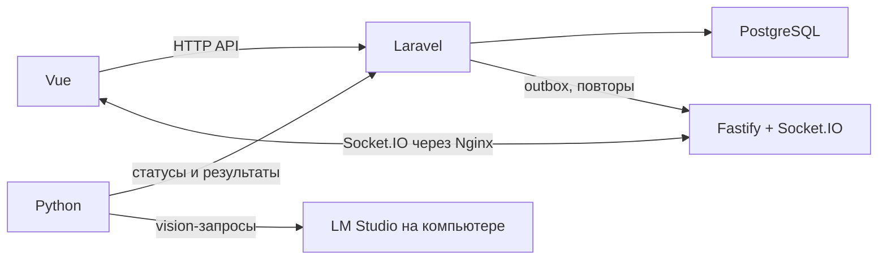

# Создать план подготовки изображений

> У меня есть LLM Studio и есть Stabile Defusion
> Надо чтоб я локально (по адресу localhost:7676) мог запустить программу в браузере (vue 3, laravel - подумай можно ли использовать laravel или может что то другое может вообще другой язык программирования).
> Надо сделать программу в которую я могу закинуть много изображений (например 500) и она должна подготовить эти изображения для обучения на них Lora для stabile defusion. Если надо должно к каждому изображению создавать описание. Т.е. если это возможно эта программа должна работать с LLM Studio, при помощи ее моделей (нужно посоветовать какая модель лучше для этого подходит), должна оценить изображения, подогнать под нужные размеры, не вырезав от туда главное (персонажа). Т.е. на выходе должна создаваться папка с подготовленными изображениями и текстами для создания Lora. Так же чтоб программа могла рекомендовать какие и сколько изображений лучше использовать для обучения лора, Т.е. из 500 изображений должна выбрать нужное количество наиболее подходящих изображений для обучения лора. Так же если на изображении два человека, такое изображение должно исключаться. Создай план в md файле для создания такой программы.  Должен быть удобный интерфейс для работы с этими изображениями как с теми что загружаются, так и с теми что создаются, так же должна быть возможность переключаться между папками с создаными отредактированными изображениями (просмотр, удаление, изменение описания)

<details><summary>4 previous messages</summary>

> Подготовлю план на русском и сохраню его в `md` в рабочем проекте. Сначала проверю структуру проекта и актуальные возможности LM Studio и инструментов для подготовки изображений, чтобы архитектура и рекомендации по моделям были привязаны к реальным ограничениям.
>
> <details><summary>Ran 2 commands, searched the web</summary>
>
> - Ran `Get-Location; Get-ChildItem -Force | Select-Object Mode,Name`
>
> Searched the web for `site:lmstudio.ai/docs local server OpenAI compatible vision image input LM Studio docs ...`
>
> - Ran `rg --files -g AGENTS.md -g README.md -g '*.md' -g '!**/.git/**';`
>
> Searched the web for `site:lmstudio.ai/models/qwen/qwen3.5-4b vision LM Studio Qwen3.5 ...`
>
> Searched the web for `site:lmstudio.ai/models/qwen/qwen3.5-9b "Vision Input" ...`
>
> </details>
>
> По найденной структуре проект пока пустой, поэтому фиксирую базовый вариант без привязки к существующему backend: Vue 3 для интерфейса и Python/FastAPI для обработки изображений. Laravel тоже справится с API, но тогда CV-обработку и локальные модели всё равно удобнее подключать отдельным Python-сервисом — для этой программы это добавит лишнюю связку. В плане учту, что для обучения обычно важнее сохранить пропорции и использовать buckets, чем насильно обрезать каждый кадр до квадрата.
>
> <details><summary>Created a file, ran 2 commands</summary>
>
> - Wrote `./PLAN.md` (+159 -0)
>
> - Ran `git status --short`
>
> - Ran `Get-Item PLAN.md | Select-Object FullName,Length; Get-Content PLAN.md -TotalCount 24`
>
> Tool call
>
> Tool: open_in_codex
> Status: completed
>
> </details>
</details>

Создал план на русском и открыл файл в Codex: [PLAN.md](./PLAN.md).

В плане выбраны Vue 3 + TypeScript для интерфейса и Python + FastAPI для backend: обработку изображений и локальный ML так проще держать в одном стеке, чем соединять Laravel с отдельным Python-сервисом. Для описаний предложен старт с Qwen3.5 4B и проверка качества на примерах перед обработкой всей коллекции; LM Studio предоставляет OpenAI-совместимый API и поддерживает модели с входными изображениями ([документация API](https://lmstudio.ai/docs/developer/openai-compat), [карточка модели](https://lmstudio.ai/models/qwen/qwen3.5-4b)).

Также описаны галерея и управление папками, поиск дублей, проверка количества людей с ручной проверкой сомнительных кадров, редактирование подписей и экспорт. Изображения предлагается сохранять с исходными пропорциями и использовать buckets, чтобы не обрезать персонажа автоматически ([документация kohya](https://github.com/bmaltais/kohya_ss/blob/master/docs/train_README.md)). 20–50 изображений указаны как начальный ориентир для отбора, а не универсальное правило.

> почему SQLite? Может mariadb или ***PostgreSQL***? Ты будешь использовать docker?

<details><summary>4 previous messages</summary>

> Объясню выбор для сценария «один пользователь, всё на одном ПК, около 500 изображений», отдельно от варианта, если позже понадобится несколько параллельных пользователей или worker-процессов. Заодно сверю ограничения SQLite и подключение контейнера к LM Studio на хосте.
>
> <details><summary>Searched the web</summary>
>
> Searched the web for `site:sqlite.org WAL one writer at a time SQLite official documentation ...`
>
> </details>
>
> Для первой версии я бы оставил SQLite и не делал Docker обязательным: 500 файлов — небольшая нагрузка на базу, потому что сами изображения лежат на диске, а в БД только метаданные. Но в исходном плане есть фоновый worker, поэтому явно добавлю условие: если понадобится много параллельных workers или несколько пользователей, перейти на PostgreSQL. Docker тогда упростит запуск PostgreSQL, но усложнит связь приложения с LM Studio на хосте.
>
> <details><summary>Edited a file, ran a command</summary>
>
> - Wrote `./PLAN.md` (+8 -0)
> - Ran `$planPath = '\\wsl.localhost\Ubuntu\home\ksv180384\projects\preparation-create-lora.local\PLAN.md'
    > $text = [System.IO.File]::ReadAllText($planPath)
    > $anchor = '- Исходники, миниатюры и экспорты располагаются под одной настраиваемой рабочей папкой приложения. Пути к файлам ограничиваются этой папкой.'
    > $insert = @'
> ### База данных и Docker
>
> - Для первой локальной версии использовать **SQLite**: приложение рассчитано на одного пользователя на одном компьютере, а 500 изображений — это в основном файлы на диске, не нагрузка на реляционную БД. Не требуется отдельно устанавливать и обслуживать сервер базы данных.
> - Включить WAL и держать транзакции короткими. SQLite разрешает одновременно читать и писать, но транзакции записи всё равно сериализуются: worker должен сохранять результаты небольшими порциями, а не держать транзакцию открытой во время анализа изображения или запроса к модели. База должна находиться на локальном диске, не на сетевой папке.
> - Перейти на **PostgreSQL**, если приложение будет обслуживать нескольких пользователей, несколько активно пишущих worker-процессов, работу по локальной сети или более крупную серверную установку. Для такого сценария PostgreSQL предпочтительнее MariaDB как основной вариант проекта; MariaDB также возможна, но для данной схемы не даёт необходимого преимущества.
> - **Docker не обязателен в MVP.** Предпочтителен простой локальный запуск приложения без установки Docker Desktop. Docker Compose можно добавить как альтернативный способ установки, особенно если вместе с PostgreSQL понадобится воспроизводимое окружение.
> - Если приложение работает в Docker на Windows, LM Studio остаётся запущенной на хосте, а backend в контейнере подключается к ней через host.docker.internal (адрес LM Studio настраивается). Порт 7676 публикуется на localhost, рабочая папка с изображениями подключается как постоянный volume. Это добавляет настройку сети и монтирования папок; GPU/ускорение для локального детектора тоже нужно отдельно проверить.
    > '@
    > if (-not $text.Contains($anchor)) { throw 'Insertion point not found' }
    > $updated = $text.Replace($anchor, $anchor + [Environment]::NewLine + [Environment]::NewLine + $insert)
    > [System.IO.File]::WriteAllText($planPath, $updated, [System.Text.UTF8Encoding]::new($false))
    > Get-Content -LiteralPath $planPath -TotalCount 36`
>
> </details>
</details>

SQLite выбрана из-за сценария: один пользователь, один компьютер, около 500 изображений. В базе будут метаданные и подписи, сами изображения останутся файлами на диске. SQLite не требует отдельного сервера и хорошо подходит для такого локального приложения.

Ограничение есть: в режиме WAL чтение и запись могут идти одновременно, но записывает в базу только один процесс за раз. Поэтому результаты обработки нужно сохранять короткими операциями. Если появятся несколько пользователей или много одновременно работающих workers, тогда лучше перейти на PostgreSQL. MariaDB тоже подойдёт, но для этой программы я не вижу причины предпочесть её PostgreSQL. [Документация SQLite](https://www.sqlite.org/wal.html), [документация PostgreSQL о конкурентном доступе](https://www.postgresql.org/docs/current/glossary.html).

**Docker в первой версии я бы не делал обязательным.** Он добавит установку и настройку, а LM Studio всё равно останется отдельной программой на компьютере. Контейнеру нужно будет подключаться к LM Studio на хосте; в Docker Desktop для этого предусмотрен адрес `host.docker.internal`. [Документация Docker](https://docs.docker.com/desktop/features/networking/networking-how-tos/).

Я добавил эти условия и рекомендацию в [PLAN.md](./PLAN.md). Docker Compose можно предусмотреть позже как альтернативу, например, если выберем PostgreSQL.

> 500 изображений  это на одного персонажа, но персонажей может быть много. Ну мы же будем использовать Vue3 для этого нужен nodejs, laravel, для этого нужен php, python и все это на WSL, для того чтоб это работало наверно нужно это делать через docker compose. Так же должна быть связь с LLM Studio

<details><summary>2 previous messages</summary>

> Да, с несколькими персонажами это уже библиотека датасетов, а не одна папка на 500 файлов. Docker Compose здесь разумен для воспроизводимого запуска. Проверю границы между Vue, backend и обработчиком, чтобы не добавлять PHP просто потому, что он нужен Laravel: Node для Vue в production обычно нужен при сборке, а не как постоянно работающий сервер.
>
> <details><summary>Ran 9 commands, searched the web</summary>
>
> Searched the web for `site:lmstudio.ai/docs developer server localhost local network bind address LM Studio server host ...`
>
> - Ran `rg -n "## 1|## 2|SQLite|Docker|500 файлов|500 изображений|### Почему|Критерии готовности|коллекц|LM Studio" PLAN.md`
>
> - Ran `$planPath = '\\wsl.localhost\Ubuntu\home\ksv180384\projects\preparation-create-lora.local\PLAN.md'
    > $text = [System.IO.File]::ReadAllText($planPath)
    > $eol = [Environment]::NewLine
>
> function Replace-LineByPrefix([string]$content, [string]$prefix, [string]$replacement) {
>     $start = $content.IndexOf($prefix)
>     if ($start -lt 0) { throw "Line prefix not found: $prefix" }
>     $end = $content.IndexOf([Environment]::NewLine, $start)
>     if ($end -lt 0) { $end = $content.Length }
>     return $content.Substring(0, $start) + $replacement + $content.Substring($end)
> }
>
> $goalPrefix = 'Локальное веб-приложение, открываемое'
> $goalText = 'Локальное приложение для библиотеки LoRA-датасетов: у пользователя может быть много персонажей/коллекций, обычно около 500 исходных изображений на персонажа. Открывается в браузере по адресу localhost:7676. Для каждой коллекции можно отдельно анализировать, отбирать и готовить изображения.'
> $text = Replace-LineByPrefix $text $goalPrefix $goalText
>
> $start = $text.IndexOf('### Backend и обработка')
> $end = $text.IndexOf('## 3. LM Studio и модели')
> if ($start -lt 0 -or $end -lt 0 -or $end -le $start) { throw 'Architecture block markers not found' }
> $newBlock = @'
> ### Backend и обработка
>
> - **Python + FastAPI** — API приложения и интеграция с локальными инструментами обработки изображений. Это оставляет CV/ML-логику в одном языке.
> - **Python worker** из того же Docker-образа выполняет долгие задания отдельно от HTTP-запросов: анализ, дубликаты, детекция людей, генерация описаний и экспорт.
> - **Pillow/OpenCV** для проверки и преобразования изображений; детектор людей запускается локально, модель детектора выбирается с учётом типа изображений и лицензии.
> - **PostgreSQL** хранит метаданные множества коллекций, результаты анализа, подписи, задания и экспорты. Изображения и миниатюры хранятся файлами в постоянной рабочей папке.
> - Рабочую папку подключать в Compose как постоянный volume. Все пути файлов ограничивать внутри неё.
>
> ### Почему PostgreSQL и Docker Compose
>
> - У каждой коллекции может быть около 500 файлов, а персонажей и заданий может быть много. Объём изображений хранится на диске; база хранит только метаданные, подписи и статусы.
> - SQLite мог бы обслужить локальный одиночный сценарий, но у него один писатель в каждый момент. С несколькими коллекциями и фоновой обработкой я предлагаю сразу PostgreSQL: worker может безопасно забирать задания из очереди с блокировкой строки, а Compose запускает БД без отдельной установки на WSL.
> - Docker Compose фиксирует версии Python, PostgreSQL и системных библиотек и запускает приложение одной командой. Порт приложения публикуется только на localhost:7676. Данные приложения и PostgreSQL лежат в постоянных volumes, поэтому сохраняются после пересоздания контейнеров.
> - Состав первой версии: app (FastAPI и собранный Vue интерфейс), worker (Python обработчик), db (PostgreSQL). Nginx не нужен, если FastAPI раздаёт собранный frontend.
> - Node.js нужен для Vite и сборки Vue. В production Node используется на этапе сборки Docker-образа; отдельный постоянно работающий Node-сервис не нужен. Для разработки можно включить отдельный Vite dev-сервис профилем Compose.
> - Для производительности исходники и рабочие данные лучше держать в файловой системе WSL, а не на смонтированном Windows-диске.
>
> ### Роль Laravel
>
> Vue 3 не требует Laravel. Laravel потребовал бы PHP и ещё один backend-слой рядом с Python, который всё равно нужен для CV/ML. Для этой программы рекомендую не добавлять PHP: FastAPI обслуживает UI/API и передаёт задания Python worker. Если Laravel уже нужен по другим причинам, его можно использовать как основной CRUD/API backend, но границу обмена заданиями с Python-сервисом придётся отдельно определить.
> '@
> $text = $text.Substring(0, $start) + $newBlock + $eol + $eol + $text.Substring($end)
>
> $lmPrefix = 'В настройках приложения пользователь указывает URL LM Studio'
> $lmText = 'В настройках приложения пользователь указывает URL LM Studio и идентификатор модели. В Docker Desktop по умолчанию проверять подключение к адресу host.docker.internal:1234/v1; адрес и порт остаются настраиваемыми. Кнопка «Проверить подключение» проверяет сервер и поддержку изображений выбранной моделью. Если LM Studio слушает только localhost и контейнер недоступен, интерфейс показывает инструкцию по настройке сетевого доступа и аутентификации; приложение не включает доступ к локальной сети автоматически.'
> $text = Replace-LineByPrefix $text $lmPrefix $lmText
>
> $entityPrefix = 'Основные сущности SQLite:'
> $entityText = 'Основные сущности PostgreSQL: Collection, ImageAsset, AnalysisResult, CaptionRevision, ProcessingJob, Export. У изображения хранить ID коллекции, относительные пути оригинала/миниатюры/обработанной копии, размеры, хеши, статус, причины, оценки и выбранную подпись.'
> $text = Replace-LineByPrefix $text $entityPrefix $entityText
>
> $phasePrefix = '- Настройки, запуск на'
> $phaseText = '- Настройки, Docker Compose, PostgreSQL, рабочая папка и сборка Vue; запуск приложения по localhost:7676.'
> $text = Replace-LineByPrefix $text $phasePrefix $phaseText
>
> $acceptPrefix = '- На компьютере пользователя можно открыть'
> $acceptText = '- Через Docker Compose можно открыть приложение по localhost:7676; создать много коллекций и импортировать не менее 500 файлов в каждую тестируемую коллекцию с видимым прогрессом.'
> $text = Replace-LineByPrefix $text $acceptPrefix $acceptText
>
> $docsMarker = '## 12. Документация'
> $extra = '- [LM Studio: доступ к серверу из локальной сети и настройка аутентификации](https://lmstudio.ai/docs/developer/core/server/serve-on-network)' + $eol + '- [Docker Desktop: подключение контейнера к сервису на хосте](https://docs.docker.com/desktop/features/networking/networking-how-tos/)' + $eol
> if (-not $text.Contains($docsMarker)) { throw 'Documentation marker not found' }
> $text = $text.Replace($docsMarker, $extra + $docsMarker)
>
> [System.IO.File]::WriteAllText($planPath, $text, [System.Text.UTF8Encoding]::new($false))
> Get-Content -LiteralPath $planPath -TotalCount 58`
>
> - Ran `$p = '\\wsl.localhost\Ubuntu\home\ksv180384\projects\preparation-create-lora.local\PLAN.md'; $t=[System.IO.File]::ReadAllText($p); Write-Output ($t.IndexOf('### Backend и обработка')); Write-Output ($t.IndexOf('## 3. LM Studio и модели')); Select-String -LiteralPath $p -Pattern 'Backend|3\. LM Studio' | Select-Object LineNumber,Line`
>
> - Ran `$p='\\wsl.localhost\Ubuntu\home\ksv180384\projects\preparation-create-lora.local\PLAN.md';$t=[System.IO.File]::ReadAllText($p);$goalStart=$t.IndexOf('Локальное веб-приложение, открываемое');$goalEnd=$t.IndexOf([Environment]::NewLine,$goalStart);$new='Локальное приложение.';$t=$t.Substring(0,$goalStart)+$new+$t.Substring($goalEnd);$s=$t.IndexOf('### Backend и обработка');$e=$t.IndexOf('## 3. LM Studio и модели');Write-Output "s=$s e=$e length=$($t.Length)"`
>
> - Ran `$p='\\wsl.localhost\Ubuntu\home\ksv180384\projects\preparation-create-lora.local\PLAN.md';$t=[System.IO.File]::ReadAllText($p);Write-Output "goal=$($t.IndexOf('Локальное веб-приложение, открываемое')) backend=$($t.IndexOf('### Backend и обработка')) end=$($t.IndexOf('## 3. LM Studio и модели')) eol=$([int][char]$t[0]) len=$($t.Length)"; Write-Output "envnewline=$([System.Environment]::NewLine.Length)"`
>
> - Ran `$planPath = '\\wsl.localhost\Ubuntu\home\ksv180384\projects\preparation-create-lora.local\PLAN.md'
    > $text = [System.IO.File]::ReadAllText($planPath)
    > $eol = [Environment]::NewLine
    > $newGoal = 'Локальное приложение для библиотеки LoRA-датасетов: у пользователя может быть много персонажей/коллекций, обычно около 500 исходных изображений на персонажа. Открывается в браузере по адресу localhost:7676. Для каждой коллекции можно отдельно анализировать, отбирать и готовить изображения.'
    > $text = [regex]::Replace($text, '(?m)^Локальное веб-приложение.*$', $newGoal, 1)
>
> $newBlock = @'
> ### Backend и обработка
>
> - **Python + FastAPI** — API приложения и интеграция с локальными инструментами обработки изображений. Это оставляет CV/ML-логику в одном языке.
> - **Python worker** из того же Docker-образа выполняет долгие задания отдельно от HTTP-запросов: анализ, дубликаты, детекция людей, генерация описаний и экспорт.
> - **Pillow/OpenCV** для проверки и преобразования изображений; детектор людей запускается локально, модель детектора выбирается с учётом типа изображений и лицензии.
> - **PostgreSQL** хранит метаданные множества коллекций, результаты анализа, подписи, задания и экспорты. Изображения и миниатюры хранятся файлами в постоянной рабочей папке.
> - Рабочую папку подключать в Compose как постоянный volume. Все пути файлов ограничивать внутри неё.
>
> ### Почему PostgreSQL и Docker Compose
>
> - У каждой коллекции может быть около 500 файлов, а персонажей и заданий может быть много. Объём изображений хранится на диске; база хранит только метаданные, подписи и статусы.
> - SQLite мог бы обслужить локальный одиночный сценарий, но у него один писатель в каждый момент. С несколькими коллекциями и фоновой обработкой я предлагаю сразу PostgreSQL: worker может безопасно забирать задания из очереди с блокировкой строки, а Compose запускает БД без отдельной установки на WSL.
> - Docker Compose фиксирует версии Python, PostgreSQL и системных библиотек и запускает приложение одной командой. Порт приложения публикуется только на localhost:7676. Данные приложения и PostgreSQL лежат в постоянных volumes, поэтому сохраняются после пересоздания контейнеров.
> - Состав первой версии: app (FastAPI и собранный Vue интерфейс), worker (Python обработчик), db (PostgreSQL). Nginx не нужен, если FastAPI раздаёт собранный frontend.
> - Node.js нужен для Vite и сборки Vue. В production Node используется на этапе сборки Docker-образа; отдельный постоянно работающий Node-сервис не нужен. Для разработки можно включить отдельный Vite dev-сервис профилем Compose.
> - Для производительности исходники и рабочие данные лучше держать в файловой системе WSL, а не на смонтированном Windows-диске.
>
> ### Роль Laravel
>
> Vue 3 не требует Laravel. Laravel потребовал бы PHP и ещё один backend-слой рядом с Python, который всё равно нужен для CV/ML. Для этой программы рекомендую не добавлять PHP: FastAPI обслуживает UI/API и передаёт задания Python worker. Если Laravel уже нужен по другим причинам, его можно использовать как основной CRUD/API backend, но границу обмена заданиями с Python-сервисом придётся отдельно определить.
>
> '@
> $text = [regex]::Replace($text, '(?s)### Backend и обработка.*?(?=## 3\. LM Studio и модели)', $newBlock, 1)
>
> $newLm = 'В настройках приложения пользователь указывает URL LM Studio и идентификатор модели. В Docker Desktop по умолчанию проверять подключение к адресу host.docker.internal:1234/v1; адрес и порт остаются настраиваемыми. Кнопка «Проверить подключение» проверяет сервер и поддержку изображений выбранной моделью. Если LM Studio слушает только localhost и контейнер недоступен, интерфейс показывает инструкцию по настройке сетевого доступа и аутентификации; приложение не включает доступ к локальной сети автоматически.'
> $text = [regex]::Replace($text, '(?m)^В настройках приложения пользователь указывает URL LM Studio.*$', $newLm, 1)
>
> $newEntity = 'Основные сущности PostgreSQL: Collection, ImageAsset, AnalysisResult, CaptionRevision, ProcessingJob, Export. У изображения хранить ID коллекции, относительные пути оригинала/миниатюры/обработанной копии, размеры, хеши, статус, причины, оценки и выбранную подпись.'
> $text = [regex]::Replace($text, '(?m)^Основные сущности SQLite:.*$', $newEntity, 1)
>
> $newPhase = '- Настройки, Docker Compose, PostgreSQL, рабочая папка и сборка Vue; запуск приложения по localhost:7676.'
> $text = [regex]::Replace($text, '(?m)^- Настройки, запуск на.*$', $newPhase, 1)
>
> $newAccept = '- Через Docker Compose можно открыть приложение по localhost:7676; создать много коллекций и импортировать не менее 500 файлов в каждую тестируемую коллекцию с видимым прогрессом.'
> $text = [regex]::Replace($text, '(?m)^- На компьютере пользователя можно открыть.*$', $newAccept, 1)
>
> $docsExtra = '- [LM Studio: доступ к серверу из локальной сети и настройка аутентификации](https://lmstudio.ai/docs/developer/core/server/serve-on-network)' + $eol + '- [Docker Desktop: подключение контейнера к сервису на хосте](https://docs.docker.com/desktop/features/networking/networking-how-tos/)' + $eol
> $text = $text.Replace('## 12. Документация', $docsExtra + '## 12. Документация')
>
> [System.IO.File]::WriteAllText($planPath, $text, [System.Text.UTF8Encoding]::new($false))
> Get-Content -LiteralPath $planPath -TotalCount 58`
>
> - Ran `rg -n "SQLite|PostgreSQL|Docker|500 файлов|500 изображений|Настройки,|Критерии|LM Studio: доступ|Docker Desktop:|Документация|## 3\." PLAN.md`
>
> - Ran `$planPath = '\\wsl.localhost\Ubuntu\home\ksv180384\projects\preparation-create-lora.local\PLAN.md'
> $text = [System.IO.File]::ReadAllText($planPath)
> $eol = [Environment]::NewLine
> $text = $text.Replace('придётся отдельно определить.' + $eol + '## 3. LM Studio и модели', 'придётся отдельно определить.' + $eol + $eol + '## 3. LM Studio и модели')
> $text = $text.Replace('- [Docker Desktop: подключение контейнера к сервису на хосте](https://docs.docker.com/desktop/features/networking/networking-how-tos/)' + $eol + '## 12. Документация', '- [Docker Desktop: подключение контейнера к сервису на хосте](https://docs.docker.com/desktop/features/networking/networking-how-tos/)' + $eol + '- [SQLite: ограничения и возможности WAL](https://www.sqlite.org/wal.html)' + $eol + '- [PostgreSQL: MVCC и конкурентный доступ](https://www.postgresql.org/docs/current/mvcc-intro.html)' + $eol + '- [Docker Compose](https://docs.docker.com/compose/)' + $eol + $eol + '## 12. Документация')
> [System.IO.File]::WriteAllText($planPath, $text, [System.Text.UTF8Encoding]::new($false))
> Get-Content -LiteralPath $planPath -TotalCount 42`
>
> - Ran `$planPath = '\\wsl.localhost\Ubuntu\home\ksv180384\projects\preparation-create-lora.local\PLAN.md'
> $text = [System.IO.File]::ReadAllText($planPath)
> $text = [regex]::Replace($text, '([^\r\n])(\r?\n)(## 3\. LM Studio и модели)', '$1$2$2$3', 1)
> [System.IO.File]::WriteAllText($planPath, $text, [System.Text.UTF8Encoding]::new($false))
> $idx = $text.IndexOf('## 3. LM Studio и модели')
> Write-Output $text.Substring($idx - 80, 110)`
>
> </details>
</details>

Да, для проекта в WSL **Docker Compose — разумный способ запуска**. Учитываю и масштаб: это много коллекций, примерно по 500 исходных изображений на персонажа.

Предлагаю зафиксировать такой состав:

- **Vue 3** — интерфейс. Node.js нужен для разработки и сборки; в обычном запуске готового приложения отдельный Node-сервис не нужен.
- **Python + FastAPI** — API и обработка изображений; отдельный Python worker разбирает долгие задания.
- **PostgreSQL** — хранит коллекции, подписи, результаты анализа и очередь заданий. 500 изображений сами по себе не требуют PostgreSQL, но для многих коллекций, фоновой обработки и Compose он здесь практичный выбор.
- **Docker Compose** запускает приложение и базу из WSL. Исходники и данные хранятся в постоянных папках/томах, приложение открывается на `localhost:7676`.

**Laravel не нужен для Vue 3.** Его можно добавить, если вы хотите именно PHP/Laravel, но тогда придётся согласовать работу Laravel с отдельным Python-сервисом. Для этой задачи я бы пока оставил один backend на Python.

Связь с LM Studio будет из контейнера по настраиваемому адресу; в Docker Desktop типичный адрес — `host.docker.internal:1234/v1`. LM Studio поддерживает OpenAI-совместимые endpoints. Если контейнер не сможет подключиться к серверу, приложение покажет настройку соединения. Важно: режим LM Studio «Serve on Local Network» открывает сервер за пределы localhost, поэтому при его включении стоит настроить аутентификацию. [LM Studio API](https://lmstudio.ai/docs/developer/openai-compat), [подключение Docker к хосту](https://docs.docker.com/desktop/features/networking/networking-how-tos/), [настройка доступа LM Studio](https://lmstudio.ai/docs/developer/core/server/serve-on-network).

Обновил план с расчётом на множество коллекций, PostgreSQL, Docker Compose и подключение к LM Studio: [PLAN.md](./PLAN.md).

> Давай Vue 3, Laravel, Python, PostgreSQL, Docker Compose. Не будем убирать Laravel. Потом нужны прогресс бары везде, при загрузке изображений, при обработке изображений. Чтоб было понятно что происходит и сколько ждать. Так же должны нормально отображаться все ошибки.

<details><summary>2 previous messages</summary>

> Зафиксирую выбранный стек без исключения Laravel. Разнесу роли явно: Laravel будет основным API и владельцем состояния заданий, Python — обработчиком изображений и интеграцией с LM Studio, Vue — интерфейсом. В план добавлю отдельные требования к прогрессу загрузки/обработки, оценке времени и отображению ошибок, а также опишу обмен заданиями между сервисами в Compose.
>
> <details><summary>Ran 9 commands, searched the web</summary>
>
> Searched the web for `site:laravel.com/docs/12.x queues database queue progress events official Laravel ...`
>
> Searched the web for `https://laravel.com/framework/docs/13.x/queues`
>
> - Ran `rg -n "^##|^###|Основные сущности|Этап 2|Критерии готовности|Документация" PLAN.md`
>
> - Ran `$planPath = '\\wsl.localhost\Ubuntu\home\ksv180384\projects\preparation-create-lora.local\PLAN.md'
    > $text = [System.IO.File]::ReadAllText($planPath)
>
> $newArchitecture = @'
> ### Интерфейс
>
> - **Vue 3 + TypeScript + Vite**: галерея, фильтры, просмотр карточек, редактирование подписей и панели заданий.
> - Node.js используется контейнером разработки и при сборке интерфейса. В собранном варианте отдельный Node-сервер не нужен.
>
> ### Laravel backend
>
> - **Laravel + PHP** — основной backend: REST API, коллекции персонажей, проверка загрузок, сохранение файлов, PostgreSQL-модели, экспорт, история заданий и ошибок.
> - Laravel остаётся единственным владельцем схемы PostgreSQL и состояния заданий. Vue общается с backend через API на том же origin.
> - Долгие операции не выполняются внутри HTTP-запроса. Laravel создаёт задание и элементы задания в PostgreSQL; Python worker получает работу через закрытые внутренние API Laravel и отправляет туда обновления прогресса/ошибок.
> - Внутренние worker-маршруты доступны только внутри Compose-сети и защищены отдельным сервисным токеном. Python worker не меняет схему БД и не пишет в таблицы Laravel напрямую.
>
> ### Python worker
>
> - **Python** выполняет CV/ML-задачи: проверку изображения, хеши дублей, детекцию людей, создание подписи через LM Studio, безопасное изменение размера и подготовку экспорта.
> - Worker работает отдельным сервисом Compose и использует общую рабочую папку с Laravel для оригиналов, миниатюр и готовых изображений.
> - Обработка каждого изображения и каждого этапа фиксируется через Laravel API. Один неудачный файл не останавливает всю коллекцию.
>
> ### PostgreSQL и Docker Compose
>
> - **PostgreSQL** хранит много коллекций, изображения как записи/метаданные, подписи, статусы и устойчивую очередь заданий. Сами изображения хранятся в файлах, а не в БД.
> - Docker Compose запускает сервисы: Nginx на localhost:7676, Laravel/PHP-FPM, Python worker и PostgreSQL. Для разработки добавляется профиль с Vite dev-сервером; production-сборка Vue создаётся Node-этапом Dockerfile и включается в образ приложения.
> - Постоянные volumes для PostgreSQL и библиотеки изображений сохраняются после пересоздания контейнеров. Код и рабочие данные рекомендуется держать в файловой системе WSL, а не на смонтированном Windows-диске.
> - Для очереди Python-задач на первом этапе использовать таблицы заданий PostgreSQL и внутренний протокол Laravel. Redis не добавлять, пока не появится практическая потребность в отдельном брокере.
>
> '@
> $text = [regex]::Replace($text, '(?s)### Интерфейс.*?(?=## 3\. LM Studio и модели)', $newArchitecture + [Environment]::NewLine, 1)
>
> $newLm = 'Laravel хранит конфигурацию LM Studio (URL, порт, модель и необязательный API-токен); Python worker получает её безопасно через внутренний API. В Docker Desktop базовый адрес обычно host.docker.internal:1234/v1, он настраиваемый. Интерфейс показывает состояние соединения. Если LM Studio слушает только localhost и контейнер недоступен, приложение подсказывает, как настроить доступ и аутентификацию; сетевой доступ не включается автоматически.'
> $text = [regex]::Replace($text, '(?m)^В настройках приложения пользователь указывает URL LM Studio.*$', $newLm, 1)
>
> $progress = @'
> ### Прогресс и отображение ошибок
>
> - **Загрузка:** общий прогресс по переданным байтам и числу файлов, отдельный прогресс каждой загрузки, скорость и оставшееся время. После завершения передачи показывать отдельный статус серверной проверки/сохранения, чтобы переданные байты не выглядели как уже обработанные изображения.
> - **Обработка коллекции:** общий прогресс задания и число завершённых изображений из общего количества; прогресс/этап каждого файла: очередь, проверка, поиск дублей, детекция людей, запрос к LM Studio, изменение размера, сохранение результата.
> - **Оценка ожидания:** показывать прошедшее время и пересчитываемый приблизительный ETA по скорости последних файлов/этапов. Если надёжную оценку ещё нельзя рассчитать, показывать текущий этап и статус ожидания, а не выдуманный процент. Время ответа LM Studio может сильно меняться.
> - **Экспорт и пакетные изменения** тоже показывают ход выполнения, успешные/пропущенные/ошибочные элементы и возможность открыть подробности.
> - Прогресс хранится в PostgreSQL, поэтому он сохраняется при обновлении страницы и перезапуске контейнера. Vue обновляет состояние через API Laravel примерно раз в секунду; прогресс-фильтр не должен зависеть от открытой вкладки.
> - **Ошибки:** понятное сообщение на русском, имя файла/коллекции, этап, код, время, можно ли повторить, и следующее действие. Показать сводку по всей задаче и список ошибок по отдельным файлам; успешные файлы не теряются из-за ошибки соседнего.
> - Для ошибки доступны повтор только неудачных элементов и копирование технических сведений. Подробный trace и журналы остаются в логах; UI показывает безопасное краткое объяснение и идентификатор ошибки. Не скрывать исключения и не отмечать частично завершённую задачу как полностью успешную.
> - Типовые причины: неподдерживаемый/повреждённый файл, нехватка диска, LM Studio недоступна, модель не загружена или не принимает изображения, таймаут, ошибка детектора, недоступный путь экспорта. Для них показывать отдельное понятное действие.
>
> '@
> $text = $text.Replace('## 5. Галерея и управление папками', $progress + '## 5. Галерея и управление папками')
>
> $newEntities = 'Основные сущности Laravel/PostgreSQL: Collection, ImageAsset, AnalysisResult, CaptionRevision, ProcessingJob, ProcessingJobItem, JobEvent и Export. Worker взаимодействует с заданиями только через внутренние Laravel API: claim задания, progress, complete/fail. Публичный API включает коллекции, файлы, подписи, задания, ошибки и прогресс; миниатюры/файлы выдаются через защищённые Laravel-маршруты с проверкой корня хранения.'
> $text = [regex]::Replace($text, '(?m)^Основные сущности PostgreSQL:.*$', $newEntities, 1)
>
> $phase2 = '- Docker Compose каркас: Laravel/PHP-FPM, Nginx, PostgreSQL и Vue-сборка; персистентная библиотека файлов; запуск через localhost:7676.'
> $text = [regex]::Replace($text, '(?m)^- Настройки, Docker Compose, PostgreSQL.*$', $phase2, 1)
> $phase3 = '- Галерея, фильтры, просмотр изображений, редактор описаний, статусы файлов, детальная панель ошибок и восстановление удалённых элементов.'
> $text = [regex]::Replace($text, '(?m)^- Галерея, фильтры, карточка изображения.*$', $phase3, 1)
> $phase4 = '- Внутренний API Laravel для worker, Python worker, очередь в PostgreSQL, LM Studio, хеши дублей, детектор людей, captions, повтор ошибок и сохранение прогресса каждого элемента.'
> $text = [regex]::Replace($text, '(?m)^- Фоновая очередь, хеши дублей.*$', $phase4, 1)
>
> $extraAccept = @'
> - Во время загрузки видны общий и файловый прогресс, скорость, ошибки передачи и серверной проверки.
> - Во время обработки видны текущий этап, общий счётчик и состояние каждого файла; ETA показывается как приблизительное и пересчитывается.
> - Ошибки не теряются: пользователь видит причину и действие, может повторить только неудавшиеся элементы; частичный успех показан явно.
> - После обновления страницы прогресс и ошибки активных/завершённых заданий остаются доступны.
    > '@
    > $text = $text.Replace('## 11. Что уточнить перед реализацией', $extraAccept + [Environment]::NewLine + '## 11. Что уточнить перед реализацией')
>
> $docExtra = '- [Laravel 13: очереди, пакетные задания и повтор ошибок](https://laravel.com/framework/docs/13.x/queues)' + [Environment]::NewLine + '- [Laravel 13: загрузка и проверка файлов](https://laravel.com/framework/docs/13.x/requests)' + [Environment]::NewLine
> $text = $text.Replace('## 12. Документация', $docExtra + [Environment]::NewLine + '## 12. Документация')
>
> [System.IO.File]::WriteAllText($planPath, $text, [System.Text.UTF8Encoding]::new($false))
> Get-Content -LiteralPath $planPath -TotalCount 85`
>
> - Ran `Get-Content PLAN.md -Tail 38`
>
> - Ran `rg -n "FastAPI|Laravel|Python|SQLite|Docker|progress|прогресс-фильтр|worker|Настройки,|Основные сущности|^##" PLAN.md`
>
> - Ran `Get-Content PLAN.md | Select-Object -Skip 118 -First 62`
>
> - Ran `$planPath = '\\wsl.localhost\Ubuntu\home\ksv180384\projects\preparation-create-lora.local\PLAN.md'
    > $text = [System.IO.File]::ReadAllText($planPath)
    > $eol = [Environment]::NewLine
>
> $section11 = @'
> ## 11. Что уточнить перед реализацией
>
> До настройки профилей экспорта полезно знать видеокарту и объём VRAM/оперативной памяти, какие базы Stable Diffusion будут целевыми (SD 1.5, SDXL или обе), и преобладают ли фотографии или рисунки/аниме. Базовое предположение для запуска — Windows с WSL2 и Docker Desktop; URL LM Studio и расположение библиотеки остаются настраиваемыми.
>
> ## 12. Документация
>
> - [Laravel 13: очереди, пакетные задания и повтор ошибок](https://laravel.com/framework/docs/13.x/queues)
> - [Laravel 13: загрузка и проверка файлов](https://laravel.com/framework/docs/13.x/requests)
> - [Vue: TypeScript и setup через Vite](https://vuejs.org/guide/typescript/overview)
> - [Docker Compose](https://docs.docker.com/compose/)
> - [Docker Compose: постоянные volumes](https://docs.docker.com/reference/compose-file/volumes/)
> - [Docker Desktop: подключение контейнера к сервису на хосте](https://docs.docker.com/desktop/features/networking/networking-how-tos/)
> - [LM Studio: OpenAI-совместимые API](https://lmstudio.ai/docs/developer/openai-compat)
> - [LM Studio: настройка сетевого доступа и аутентификации](https://lmstudio.ai/docs/developer/core/server/serve-on-network)
> - [LM Studio: каталог моделей Qwen3.5](https://lmstudio.ai/models/qwen3.5)
> - [LM Studio: карточка Qwen3.5 4B](https://lmstudio.ai/models/qwen/qwen3.5-4b)
> - [kohya-ss: подготовка данных и aspect-ratio buckets](https://github.com/bmaltais/kohya_ss/blob/master/docs/train_README.md)
> - [sd-scripts: конфигурация датасета и buckets](https://github.com/kohya-ss/sd-scripts/blob/main/docs/config_README-en.md)
> - [Ultralytics: объектная детекция и координаты найденных объектов](https://github.com/ultralytics/ultralytics/blob/main/docs/en/tasks/detect.md)
    > '@
    > $text = [regex]::Replace($text, '(?s)## 11\. Что уточнить перед реализацией.*$', $section11, 1)
>
> $text = $text.Replace('прогресс-фильтр не должен зависеть от открытой вкладки.', 'индикатор прогресса обновляется независимо от того, какая папка сейчас открыта.')
> $text = [regex]::Replace($text, '([^\r\n])(\r?\n)(## 5\. Галерея и управление папками)', '$1$2$2$3', 1)
> $text = [regex]::Replace($text, '([^\r\n])(\r?\n)(## 11\. Что уточнить перед реализацией)', '$1$2$2$3', 1)
> $text = [regex]::Replace($text, '([^\r\n])(\r?\n)(## 12\. Документация)', '$1$2$2$3', 1)
>
> $progressContract = '- API прогресса возвращает job_id, item_id, stage, percent (если вычислим), completed/total, elapsed_seconds, eta_seconds (приблизительно), status, error_code, user_message, retryable и correlation_id. Для неопределимого процента поле остаётся пустым, а интерфейс показывает этап/индикатор ожидания.'
> if (-not $text.Contains($progressContract)) {
>     $text = $text.Replace('- **Ошибки:** понятное сообщение на русском, имя файла/коллекции, этап, код, время, можно ли повторить, и следующее действие.', '- API прогресса возвращает job_id, item_id, stage, percent (если вычислим), completed/total, elapsed_seconds, eta_seconds (приблизительно), status, error_code, user_message, retryable и correlation_id. Для неопределимого процента поле остаётся пустым, а интерфейс показывает этап/индикатор ожидания.' + [Environment]::NewLine + '- **Ошибки:** понятное сообщение на русском, имя файла/коллекции, этап, код, время, можно ли повторить, и следующее действие.')
> }
>
> [System.IO.File]::WriteAllText($planPath, $text, [System.Text.UTF8Encoding]::new($false))
> Get-Content -LiteralPath $planPath -Tail 30`
>
> - Ran `Get-Content PLAN.md | Select-Object -Skip 57 -First 24; rg -n "FastAPI|SQLite|прогресс-фильтр|### Роль Laravel|Фоновая очередь|queue|error_code|progress bar" PLAN.md`
>
> - Ran `$planPath = '\\wsl.localhost\Ubuntu\home\ksv180384\projects\preparation-create-lora.local\PLAN.md'
> $text = [System.IO.File]::ReadAllText($planPath)
> $text = $text.Replace('Если надёжную оценку ещё нельзя рассчитать, показывать текущий этап и статус ожидания, а не выдуманный процент. Время ответа LM Studio может сильно меняться.', 'Если надёжный процент/ETA ещё нельзя рассчитать (например, во время генерации caption моделью), показывать анимированную неопределённую progress bar, текущий этап и прошедшее время, а не выдуманный процент. Время ответа LM Studio может сильно меняться.')
> $text = $text.Replace('Для неопределимого процента поле остаётся пустым, а интерфейс показывает этап/индикатор ожидания.', 'Для неопределимого процента поле остаётся пустым, а интерфейс показывает анимированную неопределённую progress bar, текущий этап и прошедшее время.')
> $text = $text.Replace('- **Ошибки:** понятное сообщение на русском, имя файла/коллекции, этап, код, время, можно ли повторить, и следующее действие.', '- **Ошибки:** единый журнал ошибок для Laravel, Python worker, PostgreSQL и LM Studio. Понятное сообщение на русском, имя файла/коллекции, этап, код, время, можно ли повторить, и следующее действие.')
> $text = $text.Replace('- Типовые причины: неподдерживаемый/повреждённый файл, нехватка диска, LM Studio недоступна, модель не загружена или не принимает изображения, таймаут, ошибка детектора, недоступный путь экспорта. Для них показывать отдельное понятное действие.', '- Типовые причины: неподдерживаемый/повреждённый файл, нехватка диска, Laravel API или Python worker недоступен, PostgreSQL недоступен, LM Studio недоступна, модель не загружена или не принимает изображения, таймаут, ошибка детектора, недоступный путь экспорта. Для них показывать отдельное понятное действие.')
> $text = $text.Replace('- После обновления страницы прогресс и ошибки активных/завершённых заданий остаются доступны.', '- После обновления страницы прогресс и ошибки активных/завершённых заданий остаются доступны.' + [Environment]::NewLine + '- Панель состояния показывает доступность Laravel API, PostgreSQL, Python worker и LM Studio и объясняет, что именно не подключено.')
> [System.IO.File]::WriteAllText($planPath, $text, [System.Text.UTF8Encoding]::new($false))
> Get-Content $planPath | Select-Object -Skip 62 -First 18`
>
> - Ran `$planPath = '\\wsl.localhost\Ubuntu\home\ksv180384\projects\preparation-create-lora.local\PLAN.md'
> $text = [System.IO.File]::ReadAllText($planPath)
> $text = $text.Replace('анимированную неопределённую progress bar', 'анимированный неопределённый прогресс-бар')
> $text = $text.Replace('во время генерации caption моделью', 'во время генерации подписи моделью')
> $text = $text.Replace('прогресс/ошибок.', 'прогресса, ошибок и heartbeat worker.')
> $text = $text.Replace('- Обработка каждого изображения и каждого этапа фиксируется через Laravel API. Один неудачный файл не останавливает всю коллекцию.', '- Обработка каждого изображения и каждого этапа фиксируется через Laravel API. Worker регулярно отправляет heartbeat; если он пропал, задание помечается как прерванное и доступно для повторного запуска. Один неудачный файл не останавливает всю коллекцию.')
> $text = $text.Replace('Загрузка идёт по файлам с отображением прогресса; интерфейс не отправляет 500 файлов одним монолитным запросом.', 'Загрузка идёт отдельными запросами по файлам с отображением прогресса и повтором неудачной передачи; интерфейс не отправляет все файлы одной монолитной загрузкой.')
> $text = $text.Replace('- После обновления страницы прогресс и ошибки активных/завершённых заданий остаются доступны.', '- После обновления страницы прогресс и ошибки активных/завершённых заданий остаются доступны.')
> [System.IO.File]::WriteAllText($planPath, $text, [System.Text.UTF8Encoding]::new($false))
> rg -n "FastAPI|SQLite|Laravel|прогресс-бар|heartbeat|500 исходных|## 5\\. Галерея|## 12\\. Документация" PLAN.md`
>
> Tool call
>
> Tool: open_in_codex
> Status: completed
>
> </details>
</details>

Да, Laravel остаётся. Обновил [PLAN.md](./PLAN.md) под выбранный стек и множество коллекций — примерно по 500 изображений на персонажа.

В плане теперь разделены роли: Vue 3 отвечает за интерфейс, Laravel/PHP — за API, загрузки и состояние заданий, Python worker — за обработку изображений и вызовы LM Studio, PostgreSQL — за данные и прогресс. Docker Compose запускает Nginx, Laravel, worker и базу; Node нужен для сборки Vue и разработки. Laravel поддерживает загрузку файлов и фоновые задания ([загрузка](https://laravel.com/framework/docs/13.x/requests), [очереди](https://laravel.com/framework/docs/13.x/queues)).

Добавил прогресс загрузки по файлам и байтам, этапы обработки и экспорта, приблизительный ETA и отдельный неопределённый прогресс-бар, когда точный процент рассчитать нельзя. Ошибки из Laravel, Python, PostgreSQL и LM Studio должны отображаться с файлом, этапом, причиной и возможностью повторить неудачные элементы.

Для LM Studio план предусматривает соединение из контейнера через настраиваемый адрес, обычно `host.docker.internal:1234/v1`. Если потребуется открыть сервер за пределы localhost, LM Studio рекомендует включить аутентификацию. [Подключение контейнера к хосту](https://docs.docker.com/desktop/features/networking/networking-how-tos/), [настройка сетевого доступа LM Studio](https://lmstudio.ai/docs/developer/core/server/serve-on-network).

> Ссылку на LLM Studio должно быть возможным указать в интерфейсе программы,  должна быть проверка, работает ли эта ссылка.

<details><summary>4 previous messages</summary>

> Добавлю это как отдельный сценарий настроек: ввод URL LM Studio прямо в интерфейсе, проверка доступности API и понятный результат. Проверка должна выполняться из того же Python-контейнера, который потом будет отправлять изображения, чтобы тест подтвердил реальное соединение, а не только доступность Laravel.
>
> <details><summary>Searched the web</summary>
>
> Searched the web for `site:lmstudio.ai/docs/developer/openai-compat /v1/models list models endpoint LM Studio ...`
>
> </details>
>
> Context compaction
>
> Source: automatic
> Status: completed
>
> <details><summary>Ran 4 commands</summary>
>
> - Ran `Select-String -Path PLAN.md -Pattern 'LM Studio|Критерии готовности|10\.' -Context 2,5`
>
> - Ran `$p = Get-Content -Path PLAN.md; $p[35..49]; $p[153..169]`
>
> - Ran `$path = 'PLAN.md'
    > $content = Get-Content -Raw -Path $path
    > $old = 'Laravel хранит конфигурацию LM Studio (URL, порт, модель и необязательный API-токен); Python worker получает её безопасно через внутренний API. В Docker Desktop базовый адрес обычно host.docker.internal:1234/v1, он настраиваемый. Интерфейс показывает состояние соединения. Если LM Studio слушает только localhost и контейнер недоступен, приложение подсказывает, как настроить доступ и аутентификацию; сетевой доступ не включается автоматически.'
    > $new = @'
    > В интерфейсе будет раздел **Настройки → LM Studio** с полем базового API URL (вместе со схемой, хостом и портом), необязательным API-токеном и выбором модели. Для Docker Desktop предлагается начальное значение http://host.docker.internal:1234/v1, но пользователь может указать свой адрес. Laravel хранит настройки, токен — в зашифрованном виде, а Python worker получает их через закрытый внутренний API; секреты не попадают в журналы.
>
> Кнопка **«Проверить подключение»** запускает проверку именно из Python worker: он будет обращаться к LM Studio при обработке изображений, и проверка должна подтвердить доступность из того же контейнера. Worker проверяет URL и авторизацию запросом GET /v1/models, измеряет время ответа и возвращает UI список доступных моделей. Интерфейс показывает понятный результат: подключено, тайм-аут, DNS/сетевой отказ, ошибка авторизации, неверный URL/API или недоступный список моделей; для исправимых ошибок выводится подсказка. Проверка запускается по требованию и после сохранения настроек, без ожидания начала обработки.
>
> Доступность API сама по себе не подтверждает, что выбранная модель умеет анализировать изображения. Поэтому предусмотрена отдельная **проверка vision-модели** на тестовом изображении: Python worker отправляет изображение и короткий запрос через POST /v1/chat/completions; UI показывает результат или объясняет, что модель не загружена, не поддерживает изображения либо ответила ошибкой. Для endpoint, отличающегося от стандартного, URL остаётся редактируемым. В Docker Desktop начальным адресом обычно служит host.docker.internal; если LM Studio слушает только loopback и контейнер не может подключиться, интерфейс покажет шаги по настройке сетевого доступа и аутентификации. Приложение не включает доступ к сети автоматически.
> '@
> if (-not $content.Contains($old)) { throw 'Исходный абзац LM Studio не найден; файл не изменён.' }
> $content = $content.Replace($old, $new)
> $oldCriterion = '- Пользователь может проверить подключение к LM Studio, выбрать vision-модель и создать описание для каждого принятого изображения.'
> $newCriterion = @'
> - В интерфейсе можно задать и сохранить собственный URL LM Studio, необязательный API-токен и модель; URL не зашит в код и проверяется из контейнера Python worker.
> - Проверка LM Studio отображает доступность API и модели из GET /v1/models, задержку и понятную причину ошибки; отдельная проверка vision-модели подтверждает анализ тестового изображения.
> - Пользователь может выбрать vision-модель и создать описание для каждого принятого изображения.
    > '@
    > if (-not $content.Contains($oldCriterion)) { throw 'Критерий готовности LM Studio не найден; файл не изменён.' }
    > $content = $content.Replace($oldCriterion, $newCriterion.TrimEnd())
    > Set-Content -Path $path -Value $content -Encoding utf8`
>
> - Ran `$p = Get-Content -Path PLAN.md; $p[35..49]; $p[154..165]`
>
> Tool call
>
> Tool: open_in_codex
> Status: completed
>
> </details>
</details>

Обновил план в [PLAN.md](</home/ksv180384/projects/preparation-create-lora.local/PLAN.md>).

В интерфейсе настроек будет редактируемый адрес LM Studio, необязательный API-токен и выбор модели. Проверка подключения выполнится из контейнера Python: проверит доступность API через `/v1/models`, покажет список моделей, задержку и понятное описание ошибки. Отдельная проверка на тестовом изображении подтвердит, что выбранная модель поддерживает анализ изображений. Использование `/v1/models` соответствует [документации LM Studio](https://lmstudio.ai/docs/developer/openai-compat/models); для Docker Desktop начальным адресом указан `host.docker.internal` ([документация Docker](https://docs.docker.com/desktop/features/networking/networking-how-tos/)).

> Давай еще подумай как можно улучшить эту студию по подготовки изображений для обучения Lora. Ничего не исправляй в плане, просто тут в чате напиши рекомендации

<details><summary>2 previous messages</summary>

> Подготовлю рекомендации отдельно от файла. Сверю технические моменты по документации инструментов обучения, чтобы советы по размерам, подписям и экспорту не сводились к универсальному шаблону.
>
> <details><summary>Searched the web</summary>
>
> Searched the web for `site:github.com/kohya-ss/sd-scripts documentation dataset caption bucket resolution training LoRA ...`
>
> </details>
</details>

Файл плана не менял. Вот что я бы добавил в продуктовые идеи — в порядке ожидаемой пользы.

### Для качества датасета

1. **Профиль подготовки для каждой коллекции.** При создании коллекции выбирать целевую модель — например, SD 1.5 или SDXL — и формат выгрузки. От этого зависят разрешения, buckets и настройки экспорта. У `sd-scripts` предусмотрены aspect-ratio buckets и настройка запрета увеличивать маленькие исходники; поэтому лучше сохранять пропорции и не приводить всё автоматически к квадрату. [Документация sd-scripts по конфигурации датасета](https://github.com/kohya-ss/sd-scripts/blob/main/docs/config_README-en.md)

2. **Понятный разбор причин отбора.** Для каждого изображения показывать отметки вроде «дубликат», «низкое разрешение», «размыто», «обнаружено несколько людей», «персонаж обрезан». Правило про двух людей можно сделать строгим, но сомнительные случаи лучше отправлять на ручную проверку: ошибка распознавания не должна незаметно удалить хороший кадр.

3. **Отбор по разнообразию, а не только по качеству.** Показывать группы похожих изображений и предлагать оставить из каждой группы лучшие кадры. Отдельно подсвечивать нехватку ракурсов, планов, освещения и фонов. Так рекомендации по количеству будут учитывать покрытие разнообразия: 80 разных кадров могут оказаться полезнее, чем 300 почти одинаковых.

4. **Предпросмотр кадрирования и изменения размера.** Показывать будущий результат обработки поверх рамки персонажа и давать поправить границы. Если исходник маленький, предупреждать об увеличении; сохранять оригинал и давать вернуться к нему. Для обучения важна совместимость с целевой моделью, поэтому набор профилей разрешений и пропорций практичнее единственного размера для всех файлов. [Настройки разрешений и buckets](https://github.com/kohya-ss/sd-scripts/blob/main/docs/config_README-en.md)

### Для описаний и контроля персонажей

5. **Режимы подписей.** Предусмотреть шаблоны для LoRA персонажа, одежды и стиля. В подписях можно отделять постоянные признаки персонажа от переменных деталей кадра — одежды, позы и фона. Имя-триггер задаётся в проекте и автоматически проверяется во всех `.txt`: документация sd-scripts указывает, что токен должен присутствовать в подписях для его распознавания при обучении. [Пример с token string](https://github.com/kohya-ss/sd-scripts/blob/main/docs/train_textual_inversion.md)

6. **Контроль смешения персонажей и версий.** Для коллекции хранить имя-триггер, заметки и, при необходимости, версии внешности. При импорте похожих на другой проект файлов предупреждать пользователя, что они могут относиться к другой коллекции. Это особенно пригодится, когда персонажей много.

7. **Проверка подписей перед выгрузкой.** Показывать пустые описания, забытый триггер, слишком одинаковые подписи и возможные противоречия. Для каждой подписи — рядом изображение, редактирование и массовая правка выбранных файлов. Автоматические описания стоит считать черновиками, которые можно проверить и поправить.

### Для удобной работы с большими коллекциями

8. **Сравнение кандидатов и выбор размера набора.** В отдельном отчёте показывать: сколько файлов принято, сколько исключено и почему, какие группы похожих кадров сформированы, какие ракурсы или условия представлены слабо. Рекомендацию по числу изображений сопровождать объяснением и давать несколько вариантов набора, например «компактный» и «разнообразный».

9. **Обработка без потери работы.** Добавить паузу, продолжение и повтор только упавших файлов; отмену задачи; возобновляемую загрузку; фильтр по статусам и ошибкам. Это важно, когда обработка сотен изображений прерывается или LM Studio временно недоступна. Для интерфейса полезно показывать этап конкретного файла и общий итог задачи.

10. **Аудит и готовые пакеты экспорта.** Вместе с изображениями и `.txt` сохранять manifest: исходное имя, принятый статус, подпись, применённые преобразования и профиль экспорта. Дополнительно можно сформировать конфигурационный файл датасета для выбранного тренера — настройки `sd-scripts` уже позволяют описывать разрешение, подписи и наборы данных конфигурацией. [Пример формата конфигурации](https://github.com/kohya-ss/sd-scripts/blob/main/docs/config_README-en.md)

Если выбирать первые дополнения, я бы начал с профиля целевой модели, групп похожих изображений, объяснимых причин отбора, предпросмотра кадрирования и проверки триггера в подписях. Именно они помогут избежать труднообнаружимых ошибок в готовом датасете.

> У меня основной ориентир на модели Flux, Flux 2, Flux 2 Kleine, Flux 3 Kleine, Z-Image Turbo, Qwen Image
> Добавь свои рекомендации в план

<details><summary>4 previous messages</summary>

> Добавлю рекомендации в план с отдельным профилем под ваши целевые модели. Сначала сверю названия моделей и доступность обучения LoRA по официальным источникам: для FLUX и Qwen Image конкретная поддержка зависит от версии тренера, поэтому важно не обещать универсальный экспорт.
>
> <details><summary>Searched the web</summary>
>
> Searched the web for `site:blackforestlabs.ai FLUX.2 klein LoRA training documentation ...`
>
> Searched the web for `site:github.com/ostris/ai-toolkit Qwen Image LoRA training support ...`
>
> Searched the web for `site:huggingface.co/black-forest-labs FLUX.3 Image Klein LoRA ...`
>
> </details>
>
> В официальных материалах уже видны важные различия: для FLUX.2 и FLUX.3 Klein есть отдельные base-варианты для LoRA-обучения; Z-Image Turbo и Qwen Image тоже требуют отдельных, модельных сценариев подготовки. Сейчас внесу в план матрицу профилей экспорта и идею проверки совместимости тренера, чтобы не смешивать эти форматы.
>
> <details><summary>Ran 13 commands</summary>
>
> - Ran `Select-String -Path PLAN.md -Pattern '^##|^###'`
>
> - Ran `$p = Get-Content -Path PLAN.md; $p[35..65]; $p[90..128]; $p[128..158]; $p[158..187]`
>
> - Ran `$path = 'PLAN.md'
    > $content = Get-Content -Raw -Path $path
>
> $replacements = @(
>   @{
>     Old = '1. **Создать коллекцию** и задать имя, тему LoRA, триггерное слово, целевую модель (например, SD 1.5 или SDXL) и папку экспорта.'
>     New = '1. **Создать коллекцию** и задать имя, тему LoRA, триггерное слово, точную целевую архитектуру и вариант модели (FLUX.1, FLUX.2 dev/Klein, FLUX.3 Image Klein, Z-Image Turbo или Qwen Image), профиль тренера и папку экспорта. Если для обучения нужен base/undistilled checkpoint, а LoRA планируется применять к distilled-варианту, хранить эти два выбора раздельно.'
>   },
>   @{
>     Old = 'Для LoRA одного персонажа показывать **20–50 разнообразных изображений как начальный ориентир**, а не как обязательное правило. Приложение должно объяснять итоговое предложение для конкретной коллекции: сколько файлов исключено как дубли/низкое качество/несколько людей, какие группы поз или ракурсов недопредставлены и сколько кадров предлагается взять. Ползунок размера набора и ручные исключения всегда доступны. Это эвристика; оптимум зависит от персонажа, стиля, повторяемости и параметров обучения.'
>     New = 'Показывать модельно-зависимый ориентир по размеру набора, а не универсальное число для всех архитектур. Для FLUX.2 Klein официальное руководство приводит 15–40 изображений в своём сценарии, но приложение должно считать рекомендацию эвристикой и пересчитывать её по разнообразию и качеству конкретной коллекции. Для FLUX.1/2, FLUX.3 Klein, Z-Image Turbo и Qwen Image выводить отдельный профиль и объяснение: сколько исключено как дубли/низкое качество/несколько людей, какие группы поз или ракурсов недопредставлены и сколько кадров предлагается взять. Ползунок размера набора и ручные исключения всегда доступны; финальный выбор подтверждает пользователь.'
>   }
> )
> foreach ($item in $replacements) {
>   if (-not $content.Contains($item.Old)) { throw ('Не найден ожидаемый фрагмент: ' + $item.Old) }
>   $content = $content.Replace($item.Old, $item.New)
> }
>
> $profileSection = @'
> ### Профили целевых архитектур
>
> Целевые модели — FLUX.1, FLUX.2 (включая Klein 4B/9B), FLUX.3 Image Klein, Z-Image Turbo и Qwen Image. Для каждого профиля хранить точный идентификатор чекпойнта и ревизию, модельный вариант, тренер и его проверенную версию, требования к подписи и настройкам buckets, дату проверки совместимости и статус **«проверен / экспериментальный / не поддерживается»**. Актуальность матрицы поддерживать отдельно от кода обработки изображений: новые версии моделей и тренеров не должны незаметно менять уже сохранённые настройки экспортов.
>
> В выборе профиля различать модель, на которой обучается LoRA, и модель, где она будет использоваться. Для FLUX.2 Klein и FLUX.3 Image Klein предусмотреть выбор base/undistilled checkpoint для обучения; отдельно записывать целевой вариант для инференса и проверять совместимость адаптера с ним по документации конкретной версии. Для Z-Image Turbo показывать выбранную стратегию обучения и необходимые компоненты/адаптеры конкретного тренера. Для Qwen Image и FLUX.2/3 Klein использовать отдельные архитектурные пресеты, не переносить параметры другого семейства автоматически.
>
> Набор исходников и результаты отбора хранить независимо от профиля экспорта. Это позволит подготовить из одной коллекции несколько версий датасета: например, один экспорт для FLUX.2 Klein и другой для Qwen Image, со своими размерами, captions и файлами конфигурации. Общими остаются безопасное сохранение пропорций, отсутствие незаметного upscale и ручная проверка сомнительных crop.
>
> Подписи настраивать под семейство модели и тренер: поддержать короткие теги и описательные предложения, неизменный trigger token, а также отдельные варианты шаблонов для персонажа, стиля и одежды. Перед экспортом валидировать, что trigger token присутствует согласно настройке тренера и что формат caption соответствует выбранному профилю. Для FLUX.3 Klein сохранять возможность подробных естественно-языковых описаний сцены; не навязывать такой формат всем моделям.
>
> Экспортировать универсальные пары изображение + caption и дополнительно конфигурацию только для проверенных тренеров/версий (например, YAML для AI Toolkit или TOML для Musubi Tuner/sd-scripts, если профиль это поддерживает). В manifest сохранять точные идентификаторы модели обучения и инференса, профиль тренера и его версию, размеры/buckets, версию caption-шаблона, хеши исходников и применённые преобразования. Не выдавать экспериментальную конфигурацию за проверенную.
> '@
> $marker = '## 7. Изменение размера и экспорт'
> if (-not $content.Contains($marker)) { throw 'Не найден заголовок раздела 7.' }
> $content = $content.Replace($marker, $marker + [Environment]::NewLine + [Environment]::NewLine + $profileSection.TrimEnd())
>
> $content = $content.Replace(
>   'Поддержать тренировочные профили и настройки размера, соответствующие выбранной базе Stable Diffusion. Разрешить aspect-ratio buckets; в конфигурациях kohya/sd-scripts buckets позволяют обрабатывать разные пропорции без принудительного квадратного crop.',
>   'Поддержать тренировочные профили и настройки размера для выбранной архитектуры и версии тренера. Разрешить aspect-ratio buckets там, где их поддерживает выбранный тренер; не использовать единый размер/crop для FLUX, Z-Image Turbo и Qwen Image. Конкретные buckets, лимиты разрешения и запрет upscale брать из проверенного профиля.'
> )
>
> $content = $content.Replace(
>   '### Этап 1 — проверка интеграции' + [Environment]::NewLine + [Environment]::NewLine + '- Проверить, как установленная версия LM Studio принимает изображение через выбранный OpenAI-совместимый endpoint.' + [Environment]::NewLine + '- На выборке 10–20 файлов сравнить Qwen3.5 4B и доступную более крупную модель по точности описания, обнаружению нескольких людей и времени ответа.',
>   '### Этап 1 — проверка интеграции и профилей' + [Environment]::NewLine + [Environment]::NewLine + '- Проверить, как установленная версия LM Studio принимает изображение через выбранный OpenAI-совместимый endpoint.' + [Environment]::NewLine + '- На выборке 10–20 файлов сравнить Qwen3.5 4B и доступную более крупную vision-модель по точности описания, обнаружению нескольких людей и времени ответа.' + [Environment]::NewLine + '- Составить матрицу целевых вариантов FLUX.1, FLUX.2/Klein, FLUX.3 Image Klein, Z-Image Turbo и Qwen Image: доступность в тренере, нужный checkpoint для обучения, проверенная версия, формат captions/config и ограничения профиля.' + [Environment]::NewLine + '- Для каждого заявленного профиля выполнить минимальную проверку экспорта: структура изображение/caption, разбор конфигурации выбранным тренером и короткий smoke-run на нескольких файлах, если доступно локальное GPU-окружение.'
> )
>
> $content = $content.Replace(
>   '- Создание папки обучения и ZIP, парные captions, manifest и удобный просмотр готового экспорта.',
>   '- Создание папки обучения и ZIP, парные captions, manifest и конфигурационный файл для проверенного профиля тренера; удобный просмотр готового экспорта и явная маркировка непроверенных профилей.'
> )
>
> $content = $content.Replace(
>   '- В галерее можно переключать папки/экспорты, просматривать изображения, менять и сохранять описания, удалять и восстанавливать элементы.',
>   '- В галерее можно переключать папки/экспорты, просматривать изображения, менять и сохранять описания, удалять и восстанавливать элементы.' + [Environment]::NewLine + '- Для каждой коллекции можно выбрать точную модель из списка FLUX.1, FLUX.2/Klein, FLUX.3 Image Klein, Z-Image Turbo и Qwen Image; экспортный профиль показывает проверенный тренер, требования к размеру/captions и статус совместимости.'
> )
>
> $content = $content.Replace(
>   '- Экспорт содержит выбранные изображения с теми же базовыми именами и соответствующими .txt файлами; пропорции не искажены, исходники сохранены.',
>   '- Экспорт содержит выбранные изображения с теми же базовыми именами и соответствующими .txt файлами; пропорции не искажены, исходники сохранены.' + [Environment]::NewLine + '- Для проверенных комбинаций моделей и тренеров дополнительно создаётся валидируемая конфигурация; manifest фиксирует точные model id, checkpoint обучения/инференса и версию профиля.'
> )
>
> $content = $content.Replace(
>   'До настройки профилей экспорта полезно знать видеокарту и объём VRAM/оперативной памяти, какие базы Stable Diffusion будут целевыми (SD 1.5, SDXL или обе), и преобладают ли фотографии или рисунки/аниме. Базовое предположение для запуска — Windows с WSL2 и Docker Desktop; URL LM Studio и расположение библиотеки остаются настраиваемыми.',
>   'Для точной матрицы экспорта нужно будет указать фактически используемые варианты моделей (например, FLUX.2 Klein 4B или 9B и base/distilled, FLUX.3 Image Klein Base, точный checkpoint Z-Image Turbo или Qwen Image), выбранный тренер и версию. Также важны видеокарта и объём VRAM/ОЗУ, преобладают ли фотографии или рисунки/аниме. Базовое предположение для запуска — Windows с WSL2 и Docker Desktop; URL LM Studio и расположение библиотеки остаются настраиваемыми.'
> )
>
> $docsMarker = '## 12. Документация'
> $docsAdd = @'
> - [FLUX.2 Klein: руководство BFL по LoRA и выбору base/distilled](https://huggingface.co/blog/black-forest-labs/flux-2-klein-lora)
> - [FLUX.3 Image Klein: LoRA finetuning в Diffusers](https://huggingface.co/blog/flux-3)
> - [AI Toolkit: актуальные архитектуры и конфигурации обучения](https://github.com/ostris/ai-toolkit)
> - [Musubi Tuner: обучение LoRA для Qwen Image](https://github.com/kohya-ss/musubi-tuner/blob/main/docs/qwen_image.md)
> - [Musubi Tuner: обучение Z-Image и примечания по Turbo](https://github.com/kohya-ss/musubi-tuner/blob/main/docs/zimage.md)
> - [sd-scripts: настройка датасетов и aspect-ratio buckets](https://github.com/kohya-ss/sd-scripts/blob/main/docs/config_README-en.md)
    > '@
    > if (-not $content.Contains($docsMarker)) { throw 'Не найден раздел документации.' }
    > $content = $content.Replace($docsMarker, $docsMarker + [Environment]::NewLine + [Environment]::NewLine + $docsAdd.TrimEnd())
>
> Set-Content -Path $path -Value $content -Encoding utf8`
>
> - Ran `Select-String -Path PLAN.md -Pattern '^### Профили|^Целевые модели|^- Экспорт содержит|^- Для каждой коллекции|Этап 1|До точной|FLUX.2 Klein|Qwen Image|SD 1.5|SDXL' -Context 0,2`
>
> - Ran `$p = Get-Content -Path PLAN.md; $p[111..139]; $p[141..158]; $p[167..184]; $p[191..205]`
>
> - Ran `$path = 'PLAN.md'
    > $content = Get-Content -Raw -Path $path
    > $content = $content.Replace('### Этап 1 — проверка интеграции', '### Этап 1 — проверка интеграции и профилей')
    > $stageMarker = '- Проверить детектор людей на реальных типах изображений пользователя; определить пороги автоматического исключения и ручной проверки.'
    > $stageAdd = @'
> - Составить матрицу точных целевых вариантов FLUX.1, FLUX.2/Klein, FLUX.3 Image Klein, Z-Image Turbo и Qwen Image: доступность в выбранном тренере, checkpoint для обучения, формат captions/config, требования к памяти и статус проверки.
> - Для каждого поддерживаемого профиля проверить экспорт на минимальной выборке: парность image/caption, валидность конфигурации выбранным тренером и короткий smoke-run, если GPU доступен.
    > '@
    > if (-not $content.Contains($stageMarker)) { throw 'Не найден пункт этапа 1.' }
    > $content = $content.Replace($stageMarker, $stageMarker + [Environment]::NewLine + $stageAdd.TrimEnd())
>
> $exportPrefix = '- Экспорт содержит выбранные изображения с теми же базовыми именами'
> $exportAdd = @'
> - Для поддерживаемых тренеров создаётся конфигурация, которую можно проверить выбранной версией trainer; непроверенные комбинации явно помечены.
    > '@
    > if (-not $content.Contains($exportPrefix)) { throw 'Не найден критерий экспорта.' }
    > $content = $content.Replace($exportPrefix, $exportAdd.TrimEnd() + [Environment]::NewLine + $exportPrefix)
    > Set-Content -Path $path -Value $content -Encoding utf8`
>
> - Ran `$p = Get-Content -Path PLAN.md; $p[102..139]; $p[141..159]; $p[171..188]`
>
> - Ran `$path = 'PLAN.md'
    > $content = Get-Content -Raw -Path $path
>
> $autoMarker = '- точные и близкие дубли;'
> $autoAdd = '- возможные пересечения с другими коллекциями/версиями персонажа — показывать предупреждение, но не переносить и не объединять изображения автоматически;'
> if (-not $content.Contains($autoMarker)) { throw 'Не найден список сигналов отбора.' }
> $content = $content.Replace($autoMarker, $autoMarker + [Environment]::NewLine + $autoAdd)
>
> $countMarker = 'Ползунок размера набора и ручные исключения всегда доступны; финальный выбор подтверждает пользователь.'
> $countAdd = ' Дополнительно показывать несколько вариантов состава — компактный, сбалансированный и максимально разнообразный — с визуальным сравнением групп и объяснением различий.'
> if (-not $content.Contains($countMarker)) { throw 'Не найден критерий рекомендации количества.' }
> $content = $content.Replace($countMarker, $countMarker + $countAdd)
>
> $captionMarker = 'Перед экспортом валидировать, что trigger token присутствует согласно настройке тренера и что формат caption соответствует выбранному профилю.'
> $captionAdd = ' Проверять пустые и почти дублирующиеся описания, возможные противоречия между caption и видимым содержимым, а также показывать подпись рядом с изображением для ручной сверки.'
> if (-not $content.Contains($captionMarker)) { throw 'Не найдена проверка caption.' }
> $content = $content.Replace($captionMarker, $captionMarker + $captionAdd)
>
> $sampleMarker = '- Проанализировать коллекцию в фоне. Отдельные этапы: качество и разрешение, число людей, видимость главного персонажа, VLM-описание и поиск похожих кадров. Показывать прогресс, ошибки по отдельным файлам, повторный запуск неудачных этапов и отмену задания.'
> $sampleAdd = '- До массовой обработки дать прогнать выбранную пробную группу из 10–20 изображений: сравнить подписи, решения детектора, crop/размер и скорость; после просмотра пользователь подтверждает настройки для всей коллекции.'
> if (-not $content.Contains($sampleMarker)) { throw 'Не найден шаг анализа коллекции.' }
> $content = $content.Replace($sampleMarker, $sampleMarker + [Environment]::NewLine + $sampleAdd)
>
> Set-Content -Path $path -Value $content -Encoding utf8`
>
> - Ran `$p = Get-Content -Path PLAN.md; $p[55..75]; $p[92..112]; $p[120..126]`
>
> - Ran `$path = 'PLAN.md'
    > $content = Get-Content -Raw -Path $path
>
> $autoMarker = '- точные и близкие дубли;'
> $autoAdd = '- возможные пересечения с другими коллекциями/версиями персонажа — показывать предупреждение, но не переносить и не объединять изображения автоматически;'
> if (-not $content.Contains($autoMarker)) { throw 'Не найден список сигналов отбора.' }
> $content = $content.Replace($autoMarker, $autoMarker + [Environment]::NewLine + $autoAdd)
>
> $countMarker = 'Ползунок размера набора и ручные исключения всегда доступны; финальный выбор подтверждает пользователь.'
> $countAdd = ' Дополнительно показывать несколько вариантов состава — компактный, сбалансированный и максимально разнообразный — с визуальным сравнением групп и объяснением различий.'
> if (-not $content.Contains($countMarker)) { throw 'Не найден критерий рекомендации количества.' }
> $content = $content.Replace($countMarker, $countMarker + $countAdd)
>
> $captionMarker = 'Перед экспортом валидировать, что trigger token присутствует согласно настройке тренера и что формат caption соответствует выбранному профилю.'
> $captionAdd = ' Проверять пустые и почти дублирующиеся описания, возможные противоречия между caption и видимым содержимым, а также показывать подпись рядом с изображением для ручной сверки.'
> if (-not $content.Contains($captionMarker)) { throw 'Не найдена проверка caption.' }
> $content = $content.Replace($captionMarker, $captionMarker + $captionAdd)
>
> $sampleMarker = '4. **Проанализировать коллекцию** в фоне. Отдельные этапы: качество и разрешение, число людей, видимость главного персонажа, VLM-описание и поиск похожих кадров. Показывать прогресс, ошибки по отдельным файлам, повторный запуск неудачных этапов и отмену задания.'
> $sampleAdd = '4а. **Проверить пробную группу** из 10–20 изображений до массовой обработки: сравнить подписи, решения детектора, crop/размер и скорость. После просмотра пользователь подтверждает настройки для всей коллекции.'
> if (-not $content.Contains($sampleMarker)) { throw 'Не найден шаг анализа коллекции.' }
> $content = $content.Replace($sampleMarker, $sampleMarker + [Environment]::NewLine + $sampleAdd)
>
> Set-Content -Path $path -Value $content -Encoding utf8`
>
> - Ran `$path = 'PLAN.md'
    > $content = Get-Content -Raw -Path $path
    > $old = @'
> 4. **Проанализировать коллекцию** в фоне. Отдельные этапы: качество и разрешение, число людей, видимость главного персонажа, VLM-описание и поиск похожих кадров. Показывать прогресс, ошибки по отдельным файлам, повторный запуск неудачных этапов и отмену задания.
     > 4а. **Проверить пробную группу** из 10–20 изображений до массовой обработки: сравнить подписи, решения детектора, crop/размер и скорость. После просмотра пользователь подтверждает настройки для всей коллекции.
     > '@
     > $new = '4. **Проверить пробную группу и запустить анализ.** Сначала дать прогнать 10–20 изображений, сравнить подписи, решения детектора, crop/размер и скорость; после подтверждения настроек запустить фоновый анализ всей коллекции. Отдельные этапы: качество и разрешение, число людей, видимость главного персонажа, VLM-описание и поиск похожих кадров. Показывать прогресс, ошибки по отдельным файлам, повторный запуск неудачных этапов и отмену задания.'
     > if (-not $content.Contains($old)) { throw 'Не найдены строки для объединения пробного анализа.' }
     > $content = $content.Replace($old, $new)
     > Set-Content -Path $path -Value $content -Encoding utf8`
>
> - Ran `$path = 'PLAN.md'
> $content = Get-Content -Raw -Path $path
> $oldStep = '4. **Проанализировать коллекцию** в фоне. Отдельные этапы: качество и разрешение, число людей, видимость главного персонажа, VLM-описание и поиск похожих кадров. Показывать прогресс, ошибки по отдельным файлам, повторный запуск неудачных этапов и отмену задания.'
> $newStep = '4. **Проверить пробную группу и запустить анализ.** Сначала дать прогнать 10–20 изображений, сравнить подписи, решения детектора, crop/размер и скорость; после подтверждения настроек запустить фоновый анализ всей коллекции. Этапы: качество и разрешение, число людей, видимость главного персонажа, VLM-описание и поиск похожих кадров. Показывать прогресс, ошибки по отдельным файлам, повторный запуск неудачных этапов и отмену задания.'
> $oldSubstep = '4а. **Проверить пробную группу** из 10–20 изображений до массовой обработки: сравнить подписи, решения детектора, crop/размер и скорость. После просмотра пользователь подтверждает настройки для всей коллекции.'
> if (-not $content.Contains($oldStep) -or -not $content.Contains($oldSubstep)) { throw 'Не найдены строки для объединения пробного анализа.' }
> $content = $content.Replace($oldStep, $newStep)
> $content = $content.Replace($oldSubstep, '')
> Set-Content -Path $path -Value $content -Encoding utf8`
>
> - Ran `Select-String -Path PLAN.md -Pattern '^4\.|^4а|^Целевые модели|^В выборе профиля|^Показывать модельно|^Экспортировать|^- Для поддерживаемых|^Для точной матрицы|^### Профили' -Context 0,1`
>
> Tool call
>
> Tool: open_in_codex
> Status: completed
>
> </details>
</details>

Обновил [PLAN.md](/home/ksv180384/projects/preparation-create-lora.local/PLAN.md): убрал SD 1.5/SDXL как основные ориентиры и добавил профили для **FLUX.1, FLUX.2 и Klein, FLUX.3 Image Klein, Z-Image Turbo и Qwen Image**.

В план добавлены точный выбор модели и версии тренера, отдельные варианты для обучения и применения LoRA, модельные настройки подписей и размеров, а также отметки о проверенной или экспериментальной совместимости. Из одной коллекции можно будет подготовить отдельные экспорты для разных моделей. Конфигурации тренеров планируется создавать только для проверенных сочетаний.

Добавил и рекомендации по отбору: пробная обработка 10–20 изображений, сравнение компактного и разнообразного наборов, проверка подписей и предупреждения о возможном смешении коллекций. Для FLUX.2 Klein и FLUX.3 Image Klein план учитывает различие base-моделей для обучения и distilled-вариантов для генерации согласно [руководству по FLUX.2 Klein](https://huggingface.co/blog/black-forest-labs/flux-2-klein-lora) и [документации FLUX.3 Image Klein](https://huggingface.co/blog/flux-3). Для Qwen Image и Z-Image Turbo добавлены ссылки на отдельные инструкции [Musubi Tuner](https://github.com/kohya-ss/musubi-tuner/tree/main/docs).

> Ничего что программа студии будет в docker, в wls, а LLM Studio на просто на компьютере?

<details><summary>2 previous messages</summary>

> Да, такая схема возможна. Проверю нюанс сетевого доступа между Docker в WSL2 и LM Studio, запущенной как Windows-программа: обычно решает адрес хоста, но режим прослушивания LM Studio тоже важен.
>
> <details><summary>Searched the web</summary>
>
> Searched the web for `site:lmstudio.ai/docs developer server serve on network localhost Docker host.docker.internal ...`
>
> </details>
</details>

Да, это нормальная схема. Docker Desktop с WSL2 умеет связывать контейнеры с приложениями на Windows.

```text
Браузер → localhost:7676 → контейнеры приложения
Python worker → host.docker.internal:1234 → LM Studio на Windows
```

В настройках приложения укажете `http://host.docker.internal:1234/v1`. Важно: внутри Python-контейнера `localhost` указывает на сам контейнер, поэтому для LM Studio он не подойдёт. Docker Desktop рекомендует `host.docker.internal` для доступа контейнера к сервисам на хосте. [Документация Docker](https://docs.docker.com/desktop/features/networking/networking-how-tos/)

Если проверка из Python-контейнера не пройдёт, вероятная причина — LM Studio слушает только localhost. Тогда может потребоваться включить в её настройках **Serve on Local Network**. Это откроет сервер за пределы localhost; LM Studio рекомендует включить аутентификацию. [Документация LM Studio](https://lmstudio.ai/docs/developer/core/server/serve-on-network)

В плане уже предусмотрена проверка подключения именно из Python worker — так интерфейс проверит доступ тем же способом, которым приложение будет обращаться к моделям. Рекомендованная схема — Docker Desktop с включённой интеграцией WSL2. Если запускать Docker Engine отдельно внутри дистрибутива WSL, адрес Windows-хоста может потребовать другой настройки.

> подумай что еще можно улучшить и доработать. План не меняй, просто напиши в чат

План не менял. Для студии я бы ещё рассмотрел такие улучшения:

1. **Проверка, что все изображения относятся к нужному персонажу.** Пользователь выбирает несколько эталонных изображений, а программа подсвечивает возможных «чужих» персонажей и визуальные выбросы в коллекции. Это полезно для проектов с большим количеством LoRA. Оценку стоит показывать как подсказку: для рисунков и аниме автоматическое сравнение может ошибаться.

2. **Очередь ручной проверки.** Отдельный экран только для спорных случаев: рядом показываются похожие кадры, причина сомнения и кнопки принятия или исключения. Горячие клавиши и групповые действия помогут разобрать сотни файлов быстрее. Уже принятые изображения можно «закреплять», чтобы последующая рекомендация их не исключала.

3. **Карта состава набора.** Показывать не только общий балл, но и сколько в коллекции крупных планов, кадров по пояс и в полный рост, разных ракурсов, одежды и фонов. Пользователь сможет задать пожелания, например оставить минимум несколько портретов и кадров в полный рост, а затем сравнить несколько вариантов набора.

4. **Повторная обработка только того, что изменилось.** Сохранять версии модели описаний, шаблона caption, профиля экспорта и алгоритмов анализа. Если поменяли подпись или размер — пересобрать соответствующие результаты, не гоняя повторно детектор и анализ всех изображений.

5. **Предэкспортная проверка.** Перед созданием папки показывать отчёт: нет ли файлов без подписи, совпадающих имён, неподдерживаемых форматов, повреждённых изображений и ошибок конфигурации тренера. Готовый экспорт лучше сначала собирать во временную папку и публиковать как завершённый только после успешной проверки.

6. **Управление нагрузкой LM Studio.** Дать ограничивать число одновременных запросов и приостанавливать очередь. Для большой коллекции это поможет избежать перегрузки памяти модели и объяснит замедление: например, отдельно показывать ожидание загрузки модели и обработку изображения.

7. **Резервное копирование и приватность.** Добавить резервную копию базы, подписей и настроек с восстановлением. При экспорте можно предлагать удалить из копий геоданные EXIF, сохранив оригиналы. Сам интерфейс стоит привязать только к `127.0.0.1:7676`, чтобы случайно не открыть его в локальную сеть.

После обучения LoRA можно отдельно добавить **набор контрольных промптов**: пользователь запускает их для базовой модели и LoRA при одинаковых настройках и сравнивает результат. Это не часть подготовки датасета, поэтому я бы оставил такую функцию на будущее.

> Пункты 2,3,4,5,6 добавь в план. При работе с LM Studio учти что у меня видеокарта 4070 ti super 16 gb

<details><summary>2 previous messages</summary>

> Добавлю пункты 2–6 в соответствующие разделы плана и отдельно учту 16 ГБ VRAM: нагрузку LM Studio, очередность задач и пробный замер моделей, без предположения, что более крупная модель обязательно поместится вместе с остальными процессами.
>
> <details><summary>Ran 6 commands, searched the web</summary>
>
> Searched the web for `site:lmstudio.ai/models/qwen3.5-4b Qwen3.5 4B vision LM Studio memory ...`
>
> - Ran `$p = Get-Content -Path PLAN.md; $p[33..55]; $p[59..112]; $p[155..210]`
>
> - Ran `$path = 'PLAN.md'
    > $content = Get-Content -Raw -Path $path
>
> $old = '- Начать с **Qwen3.5 4B** в LM Studio как доступного по ресурсам VLM-варианта; в каталоге LM Studio у него указана поддержка изображения и 4 GB минимальной системной памяти.'
> $new = '- Для RTX 4070 Ti Super с 16 GB VRAM начать с vision-модели **Qwen3.5 4B** в квантованном варианте, доступном в LM Studio. Указанные каталогом 4 GB минимальной системной памяти — не требование к VRAM; фактический расход видеопамяти зависит от квантования, длины контекста, обработки изображения и загрузки других GPU-программ.'
> if (-not $content.Contains($old)) { throw 'Не найден совет по Qwen3.5 4B.' }
> $content = $content.Replace($old, $new)
>
> $old = '- Если качество описаний недостаточно, сравнить на небольшой выборке **Qwen3.5 9B**. У каталога LM Studio размер файла модели указан примерно как 7 GB; фактическое потребление памяти зависит от квантизации, контекста и настроек загрузки.'
> $new = '- Если качество 4B недостаточно, сравнить **Qwen3.5 9B** на 10–20 изображениях. Размер файла модели не считать оценкой расхода VRAM: перед загрузкой сверять ресурсную оценку LM Studio с доступными 16 GB и проверять реальное потребление с выбранным контекстом.'
> if (-not $content.Contains($old)) { throw 'Не найден совет по Qwen3.5 9B.' }
> $content = $content.Replace($old, $new)
>
> $old = '- **Qwen3.5 27B** — необязательный более крупный вариант для компьютера с достаточной памятью (в каталоге указано 17 GB минимальной системной памяти). Это не обязательное требование для приложения.'
> $new = '- **Qwen3.5 27B** не предлагать как штатный вариант для 16 GB VRAM. При желании пользователь может проверить его с частичной выгрузкой слоёв в RAM, понимая, что это может заметно замедлить обработку; перед загрузкой использовать оценку ресурсов LM Studio.'
> if (-not $content.Contains($old)) { throw 'Не найден совет по Qwen3.5 27B.' }
> $content = $content.Replace($old, $new)
>
> $benchmarkLine = '- Рекомендация по модели предварительная: перед массовой обработкой пользователь прогоняет 10–20 типичных изображений и выбирает вариант по точности и скорости именно на своём ПК.'
> $gpuNote = @'
> Для 16 GB VRAM задать безопасный режим обработки: по умолчанию не более одного активного запроса к vision-модели LM Studio; CPU-этапы могут выполняться параллельно, а другие GPU-этапы Python не запускаются одновременно с caption inference без явного разрешения. Ограничивать размер отправляемого изображения и контекст настройками профиля; не передавать всю коллекцию одним запросом. При нехватке памяти/тайм-ауте ставить очередь на паузу, показывать причину и предлагать повтор после освобождения GPU. Перед массовой задачей провести замер на пробной группе; не считать все 16 GB свободными, если параллельно открыты ComfyUI, генерация или обучение.
> '@
> if (-not $content.Contains($benchmarkLine)) { throw 'Не найдено место для аппаратных рекомендаций.' }
> $content = $content.Replace($benchmarkLine, $benchmarkLine + [Environment]::NewLine + [Environment]::NewLine + $gpuNote.TrimEnd())
>
> $galleryMarker = '- Фильтры по статусу, оценке, числу людей, дубликатам, разрешению, формату и наличию описания.'
> $galleryAdd = @'
> - Отдельная очередь «Требует проверки», отсортированная по степени неопределённости; для дублей и похожих кадров показывать изображения рядом с причиной совпадения.
> - Быстрые клавиши и пакетная обработка для принятия/исключения; принятое изображение можно закрепить, чтобы рекомендация не исключала его автоматически.
    > '@
    > if (-not $content.Contains($galleryMarker)) { throw 'Не найден фильтр галереи.' }
    > $content = $content.Replace($galleryMarker, $galleryMarker + [Environment]::NewLine + $galleryAdd.TrimEnd())
>
> $coverageMarker = '- разнообразие оставшегося набора по позам, кадрированию, фону и освещению.'
> $coverageAdd = '- покрытие коллекции по планам и ракурсам (крупный план, по пояс, в полный рост, профиль/анфас), одежде и окружению; давать пользователю задавать желаемые минимумы без автоматического удаления других категорий.'
> if (-not $content.Contains($coverageMarker)) { throw 'Не найден сигнал разнообразия.' }
> $content = $content.Replace($coverageMarker, $coverageMarker + [Environment]::NewLine + $coverageAdd)
>
> $progressMarker = 'прогресс/этап каждого файла: очередь, проверка, поиск дублей, детекция людей, запрос к LM Studio, изменение размера, сохранение результата.'
> $progressAdd = ' Явно показывать ожидание слота LM Studio/GPU отдельно от времени фактической генерации подписи.'
> if (-not $content.Contains($progressMarker)) { throw 'Не найден список этапов прогресса.' }
> $content = $content.Replace($progressMarker, $progressMarker + $progressAdd)
>
> $exportMarker = '- Поддержать копирование в обычную структуру обучения и ZIP-архив. Экспорт не меняет исходники.'
> $preflight = @'
>
> Перед публикацией экспорта выполнять preflight: проверить выбранный состав, поддерживаемость форматов, совпадение имён image/caption, отсутствие пустых captions и коллизий имён, целостность записанных файлов, достаточность места на диске и корректность конфигурации по схеме выбранного профиля. Показать отчёт с ошибками и предупреждениями. Собирать экспорт во временную папку и помечать его завершённым/перемещать на итоговый путь только после успешной проверки; при сбое оставить исходную коллекцию нетронутой и предложить повтор.
> '@
> if (-not $content.Contains($exportMarker)) { throw 'Не найден пункт экспорта.' }
> $content = $content.Replace($exportMarker, $exportMarker + $preflight)
>
> $entitiesOld = 'Основные сущности Laravel/PostgreSQL: Collection, ImageAsset, AnalysisResult, CaptionRevision, ProcessingJob, ProcessingJobItem, JobEvent и Export. Worker взаимодействует с заданиями только через внутренние Laravel API: claim задания, progress, complete/fail. Публичный API включает коллекции, файлы, подписи, задания, ошибки и прогресс; миниатюры/файлы выдаются через защищённые Laravel-маршруты с проверкой корня хранения.'
> $entitiesNew = @'
> Основные сущности Laravel/PostgreSQL: Collection, ImageAsset, AnalysisResult, CaptionRevision, ProcessingJob, ProcessingJobItem, JobEvent, Export и ExportPreflight. Worker взаимодействует с заданиями только через внутренние Laravel API: claim задания, progress, complete/fail. Публичный API включает коллекции, файлы, подписи, задания, ошибки и прогресс; миниатюры/файлы выдаются через защищённые Laravel-маршруты с проверкой корня хранения.
>
> Каждый этап анализа хранит fingerprint исходного файла и версию/хеш своих параметров: модель и ревизию VLM, prompt-шаблон, детектор, модельный профиль и настройки преобразования. Совпадающий этап можно повторно использовать. Изменение текста caption не запускает повторно детектор; изменение профиля экспорта пересобирает только нужные производные файлы; изменение исходника или версии детектора инвалидирует соответствующие результаты. У экспорта сохранять номер ревизии и diff состава/подписей относительно предыдущей версии.
> '@
> if (-not $content.Contains($entitiesOld)) { throw 'Не найден блок основных сущностей.' }
> $content = $content.Replace($entitiesOld, $entitiesNew)
>
> Set-Content -Path $path -Value $content -Encoding utf8`
>
> - Ran `Select-String -Path PLAN.md -Pattern '^### Этап 3|^### Этап 4|^### Этап 5|^### Этап 6|^Для точной матрицы|^## 10|^## 12|Qwen3.5 4B|16 GB VRAM|host.docker.internal' -Context 0,2`
>
> - Ran `$path = 'PLAN.md'
    > $content = Get-Content -Raw -Path $path
>
> $lmNote = 'Для 16 GB VRAM задать безопасный режим обработки: по умолчанию не более одного активного запроса к vision-модели LM Studio; CPU-этапы могут выполняться параллельно, а другие GPU-этапы Python не запускаются одновременно с caption inference без явного разрешения. Ограничивать размер отправляемого изображения и контекст настройками профиля; не передавать всю коллекцию одним запросом. При нехватке памяти/тайм-ауте ставить очередь на паузу, показывать причину и предлагать повтор после освобождения GPU. Перед массовой задачей провести замер на пробной группе; не считать все 16 GB свободными, если параллельно открыты ComfyUI, генерация или обучение.'
> $lmNoteNew = $lmNote + ' Приложение не меняет GPU offload и контекст LM Studio автоматически: показывает, загружена ли выбранная модель, и даёт инструкции/ссылку на оценку ресурсов LM Studio перед её загрузкой. На этой машине начать с квантованной Qwen3.5 4B; Qwen3.5 9B использовать только после проверки фактического запаса VRAM и качества. Для подготовки датасета LoRA-обучение не запускать.'
> if (-not $content.Contains($lmNote)) { throw 'Не найден блок режима 16 GB VRAM.' }
> $content = $content.Replace($lmNote, $lmNoteNew)
>
> $errorMarker = 'LM Studio недоступна, модель не загружена или не принимает изображения, таймаут, ошибка детектора'
> $errorAdd = ' или нехватка VRAM/ошибка CUDA'
> if (-not $content.Contains($errorMarker)) { throw 'Не найден список типовых ошибок.' }
> $content = $content.Replace($errorMarker, $errorMarker + $errorAdd)
>
> $galleryStageOld = '- Галерея, фильтры, просмотр изображений, редактор описаний, статусы файлов, детальная панель ошибок и восстановление удалённых элементов.'
> $galleryStageNew = '- Галерея, фильтры, просмотр изображений, редактор описаний, статусы файлов, детальная панель ошибок и восстановление удалённых элементов. Добавить очередь ручной проверки, сравнение похожих изображений рядом и быстрые клавиши; дать закреплять принятые кадры.'
> if (-not $content.Contains($galleryStageOld)) { throw 'Не найден этап 3.' }
> $content = $content.Replace($galleryStageOld, $galleryStageNew)
>
> $analysisStageOld = '- Внутренний API Laravel для worker, Python worker, очередь в PostgreSQL, LM Studio, хеши дублей, детектор людей, captions, повтор ошибок и сохранение прогресса каждого элемента.'
> $analysisStageNew = '- Внутренний API Laravel для worker, Python worker, очередь в PostgreSQL, LM Studio, хеши дублей, детектор людей, captions, повтор ошибок и сохранение прогресса каждого элемента. Добавить fingerprints этапов и конфигураций для безопасного повторного использования неизменённых результатов; ограничить одновременные обращения к LM Studio одной задачей по умолчанию.'
> if (-not $content.Contains($analysisStageOld)) { throw 'Не найден этап 4.' }
> $content = $content.Replace($analysisStageOld, $analysisStageNew)
>
> $selectStageOld = '- Отчёт о составе коллекции, диверсифицированный ранжированный отбор, понятные причины оценки, профили разрешения и просмотр до/после.'
> $selectStageNew = '- Отчёт о составе коллекции, диверсифицированный ранжированный отбор, понятные причины оценки, покрытие планов/ракурсов, варианты компактного/сбалансированного/разнообразного набора, профили разрешения и просмотр до/после.'
> if (-not $content.Contains($selectStageOld)) { throw 'Не найден этап 5.' }
> $content = $content.Replace($selectStageOld, $selectStageNew)
>
> $exportStageOld = '- Создание папки обучения и ZIP, парные captions, manifest и конфигурационный файл для проверенного профиля тренера; удобный просмотр готового экспорта и явная маркировка непроверенных профилей.'
> $exportStageNew = '- Создание папки обучения и ZIP, парные captions, manifest и конфигурационный файл для проверенного профиля тренера; preflight-отчёт, сборка во временную папку и публикация только после полной проверки.'
> if (-not $content.Contains($exportStageOld)) { throw 'Не найден этап 6.' }
> $content = $content.Replace($exportStageOld, $exportStageNew)
>
> $criteriumGallery = '- В галерее можно переключать папки/экспорты, просматривать изображения, менять и сохранять описания, удалять и восстанавливать элементы.'
> $criteriumAdd = @'
> - Очередь ручной проверки показывает спорные кадры и дубли рядом; решения принимаются с клавиатуры и групповых действий, закреплённые кадры остаются в наборе.
> - Отчёт показывает покрытие коллекции по планам и ракурсам; доступны варианты компактного, сбалансированного и разнообразного набора и сравнение их состава.
> - Повторная обработка переиспользует результаты этапов с совпадающими входными fingerprint и настройками; изменение одного этапа не запускает все остальные заново.
    > '@
    > if (-not $content.Contains($criteriumGallery)) { throw 'Не найден критерий галереи.' }
    > $content = $content.Replace($criteriumGallery, $criteriumGallery + [Environment]::NewLine + $criteriumAdd.TrimEnd())
>
> $criteriumExport = '- Для поддерживаемых тренеров создаётся конфигурация, которую можно проверить выбранной версией trainer; непроверенные комбинации явно помечены.'
> $criteriumExportAdd = '- Перед публикацией экспорта UI показывает preflight ошибок/предупреждений; проверяются пары image/caption, коллизии имён, целостность файлов, место на диске и конфигурация профиля. Незавершённый экспорт не отображается как готовый.'
> if (-not $content.Contains($criteriumExport)) { throw 'Не найден критерий экспортного профиля.' }
> $content = $content.Replace($criteriumExport, $criteriumExport + [Environment]::NewLine + $criteriumExportAdd)
>
> $criteriumProgress = '- Панель состояния показывает доступность Laravel API, PostgreSQL, Python worker и LM Studio и объясняет, что именно не подключено.'
> $criteriumGpu = '- Для RTX 4070 Ti Super 16 GB VRAM обработка по умолчанию ограничивает одновременную vision-генерацию одним запросом; очередь умеет ждать/ставиться на паузу при занятом GPU, timeout и нехватке VRAM.'
> if (-not $content.Contains($criteriumProgress)) { throw 'Не найден критерий панели состояния.' }
> $content = $content.Replace($criteriumProgress, $criteriumProgress + [Environment]::NewLine + $criteriumGpu)
>
> $hardwareOld = 'Для точной матрицы экспорта нужно будет указать фактически используемые варианты моделей (например, FLUX.2 Klein 4B или 9B и base/distilled, FLUX.3 Image Klein Base, точный checkpoint Z-Image Turbo или Qwen Image), выбранный тренер и версию. Также важны видеокарта и объём VRAM/ОЗУ, преобладают ли фотографии или рисунки/аниме. Базовое предположение для запуска — Windows с WSL2 и Docker Desktop; URL LM Studio и расположение библиотеки остаются настраиваемыми.'
> $hardwareNew = 'Подтверждённая видеокарта для исходного профиля — RTX 4070 Ti Super с 16 GB VRAM; объём системной RAM ещё уточнить. Для vision-captioning начать с квантованной Qwen3.5 4B, а Qwen3.5 9B включать после замера ресурсоёмкости и качества на этой машине. Перед точной матрицей экспорта нужно указать фактические варианты целевых моделей, выбранный тренер и его версию; также важно, преобладают ли фотографии или рисунки/аниме. Базовое предположение для запуска — Windows с WSL2 и Docker Desktop; URL LM Studio и расположение библиотеки остаются настраиваемыми.'
> if (-not $content.Contains($hardwareOld)) { throw 'Не найден блок уточнений по оборудованию.' }
> $content = $content.Replace($hardwareOld, $hardwareNew)
>
> Set-Content -Path $path -Value $content -Encoding utf8`
>
> - Ran `$path = 'PLAN.md'
    > $content = Get-Content -Raw -Path $path
    > $marker = '- [LM Studio: карточка Qwen3.5 4B](https://lmstudio.ai/models/qwen/qwen3.5-4b)'
    > $extra = @'
> - [LM Studio: оценка расхода памяти, GPU offload и длины контекста](https://beta.lmstudio.ai/docs/cli/load)
> - [LM Studio: характеристики моделей и признак поддержки vision](https://beta.lmstudio.ai/docs/developer/rest/list)
> - [LM Studio: каталог вариантов Qwen3.5 и размеры файлов](https://lmstudio.ai/models/qwen3.5)
    > '@
    > if (-not $content.Contains($marker)) { throw 'Не найдена ссылка на Qwen3.5 4B.' }
    > $content = $content.Replace($marker, $marker + [Environment]::NewLine + $extra.TrimEnd())
    > Set-Content -Path $path -Value $content -Encoding utf8`
>
> - Ran `Select-String -Path PLAN.md -Pattern 'RTX 4070|one active|одного активного|очередь|fingerprint|preflight|покрытие|компактный|LM Studio: оценка расхода|Qwen3.5 27B' -Context 0,1`
>
> Tool call
>
> Tool: open_in_codex
> Status: completed
>
> </details>
</details>

Обновил [PLAN.md](/home/ksv180384/projects/preparation-create-lora.local/PLAN.md).

Добавил очередь спорных изображений с просмотром похожих кадров рядом, быстрыми действиями и закреплением выбранных снимков; отчёт по планам и ракурсам с вариантами компактного, сбалансированного и разнообразного набора; повторное использование результатов неизменённых этапов; проверку экспорта до публикации.

Для вашей **RTX 4070 Ti Super с 16 ГБ VRAM** в плане теперь предусмотрен один активный запрос к vision-модели LM Studio по умолчанию, пауза очереди при нехватке памяти и разделение ожидания GPU и обработки в прогрессе. Начальный кандидат — квантованная Qwen3.5 4B; 9B предлагается проверять на пробной группе и после оценки ресурсов. Размер модели на диске сам по себе не показывает расход VRAM: оценка LM Studio учитывает, среди прочего, контекст и vision-нагрузку. [Каталог Qwen3.5 в LM Studio](https://lmstudio.ai/models/qwen3.5), [оценка памяти в LM Studio](https://beta.lmstudio.ai/docs/cli/load).

> Может для интерактивности приложения использовать сокеты чтоб не надо было перезагружать страницу для получения результатов выполнения действий приложения, так же и прогресс быры чтоб отображали текущий прогресс выполнения. Или может это уже учтно?

<details><summary>2 previous messages</summary>

> Проверю формулировку в плане и актуальный вариант realtime-механизма для Laravel. Тут важно разделить локальный прогресс передачи файлов и прогресс фоновой обработки: их лучше получать разными путями.
>
> <details><summary>Searched the web</summary>
>
> Searched the web for `site:laravel.com/docs broadcasting Reverb Laravel 13 WebSockets ...`
>
> </details>
</details>

**Без перезагрузки страницы уже предусмотрено:** план говорит, что Vue опрашивает Laravel API примерно раз в секунду, а состояние заданий сохраняется в PostgreSQL. Но WebSockets в плане пока не указаны, поэтому обновление может приходить с задержкой до секунды.

Для этой задачи я бы добавил **Laravel Reverb**:

- Vue получает по WebSocket события о стадиях обработки и обновлении прогресса.
- Python worker отправляет результаты Laravel, а Laravel рассылает их в браузер.
- При потере соединения интерфейс получает актуальный снимок задания через API и временно возвращается к опросу.

Передача файлов — отдельный случай: её прогресс браузер может показывать напрямую по событиям загрузки, а WebSocket оставить для обработки на сервере. Это позволит видеть движение полосы загрузки сразу, а не ждать ответа фоновой задачи.

Laravel поддерживает вещание событий через WebSockets и Reverb; документация описывает его как альтернативу постоянному опросу API. [Broadcasting в Laravel](https://laravel.com/framework/docs/broadcasting), [Laravel Reverb](https://laravel.com/framework/docs/reverb).

> Давай не чрез Laravel Reverb, а через node js, который будет работать примерно так. Выполняется задача, например в python или в laravel, на каком то этапе выполнения или после выполнения дергается определенный путь к node js (например Fastify), который у себя дергает сокет и сокет оже отправляет событие на фронт. Как тебе такой вариант?

<details><summary>2 previous messages</summary>

> Идея рабочая. Разберу её как отдельный realtime-шлюз и уточню важные места: надёжность событий при перезапуске Node, безопасная маршрутизация по заданиям и какой WebSocket-инструмент лучше подойдёт Vue + Fastify.
>
> <details><summary>Searched the web</summary>
>
> Searched the web for `Fastify official @fastify/websocket documentation GitHub plugin ...`
>
> </details>
</details>

Да, **Fastify как realtime-шлюз — рабочая схема**. Для вашего приложения я бы построил поток так:

```text
Python worker → Laravel API → PostgreSQL
                     │
                     └─ после сохранения прогресса → внутренний HTTP-запрос → Fastify/Socket.IO → Vue
```

Я бы оставил Laravel единственным владельцем состояния заданий: worker уже сообщает ему прогресс, Laravel сохраняет его в PostgreSQL, а затем отправляет уведомление Node. Так задача продолжит работать, даже если Node или сокет временно недоступен. После переподключения браузер запросит актуальный статус через API; можно также показать резервный прогресс через опрос API.

Для браузера я бы выбрал **Socket.IO поверх Fastify**: он умеет переподключаться и поддерживает комнаты, например отдельную для каждого задания. Низкоуровневый `@fastify/websocket` тоже подойдёт, но переподключение и маршрутизацию событий придётся организовать самостоятельно. [Fastify WebSocket](https://github.com/fastify/fastify-websocket), [Socket.IO: доставка событий](https://socket.io/docs/v4/delivery-guarantees/).

Прогресс загрузки файлов Vue может получать непосредственно от браузера. Сокет нужен для событий фоновой обработки: смены этапа, результата отдельного файла, ошибки и завершения задания. События стоит ограничить изменениями прогресса и переходами между этапами, а не посылать непрерывный поток мелких обновлений. Socket.IO сам по себе не хранит пропущенные события, поэтому PostgreSQL/API должны оставаться источником актуального состояния.

Это добавит отдельный Node-сервис в Docker Compose, но даст нужное обновление интерфейса без перезагрузки страницы и без привязки Python worker напрямую к сокетам. Сейчас в плане описаны опрос API примерно раз в секунду и сохранение прогресса; вариант с Fastify/Socket.IO пока не добавлен.

> как думаешь что лучше, **Laravel Reverb**  или node?

<details><summary>3 previous messages</summary>

> Сравню по вашему конкретному стеку, а не в общем: Laravel уже ведёт задания и хранит их прогресс, а Python worker отчитывается через Laravel. Проверю актуальные официальные материалы по Reverb и Socket.IO и дам рекомендацию без изменений плана.
>
> <details><summary>Searched the web</summary>
>
> Searched the web for `site:laravel.com/framework/docs/13.x/reverb Laravel Reverb broadcasting setup scaling Redis ...`
>
> </details>
>
> Context compaction
>
> Source: automatic
> Status: completed
</details>

Для выбранного стека я бы выбрал **Laravel Reverb**. Состояние задач и данные уже ведёт Laravel, поэтому он может публиковать события напрямую в Reverb, а Vue будет получать обновления через Laravel Echo. Это проще сопровождать, чем добавлять отдельный Node-сервис с собственными API, авторизацией и восстановлением состояния. [Документация Laravel Reverb](https://laravel.com/framework/docs/reverb) · [Laravel Broadcasting](https://laravel.com/framework/docs/broadcasting)

Поток получится таким: Python сообщает Laravel о ходе обработки → Laravel сохраняет прогресс в PostgreSQL и отправляет событие в Reverb → Vue обновляет прогресс-бар. После переподключения браузер запрашивает у Laravel актуальное состояние задачи: WebSocket-события сами по себе не заменяют сохранённое состояние. [Гарантии доставки Socket.IO](https://socket.io/docs/v4/delivery-guarantees/)

**Node/Fastify** имеет смысл, если позже появится отдельный общий Node-шлюз для нескольких приложений или сервисов. Для локальной студии с Vue, Laravel и Python Reverb выглядит проще. В текущем плане пока указано обновление через polling примерно раз в секунду; если решим перейти на Reverb, этот пункт нужно будет заменить.

> Не, давай лучше через Node/Fastify/socket.io. Добавь это в план

<details><summary>4 previous messages</summary>

> Обновлю план: Node/Fastify с Socket.IO станет отдельным realtime-шлюзом, а Laravel и PostgreSQL останутся источником сохранённого состояния задач. Добавлю поток событий между Python/Laravel и шлюзом, прогресс, переподключение и обработку ошибок.
>
> <details><summary>Edited a file, explored a file, ran 6 commands</summary>
>
> <details><summary>Explored a file</summary>
>
> - Read `./PLAN.md`
>
> </details>
>
> - Ran `Select-String -Path PLAN.md -Pattern 'Node.js используется|Docker Compose запускает|Прогресс хранится|Основные сущности|Этап 2|Panel состояния|Панель состояния|Vue обновляет|обновляет состояние через API|localhost:7676' -Context 2,3`
>
> - Ran `$c = Get-Content PLAN.md; for ($i=140; $i -lt [Math]::Min($c.Length,158); $i++) { '{0}: {1}' -f ($i+1), $c[$i] }`
>
> - Wrote `./PLAN.md` (+24 -6)
>
> - Ran ``python3 - <<'PY'
> from pathlib import Path
> p = Path('PLAN.md')
> s = p.read_text()
> replacements = [
> ("- Node.js используется контейнером разработки и при сборке интерфейса. В собранном варианте отдельный Node-сервер не нужен.", "- **Node.js + Fastify + Socket.IO** — отдельный realtime-сервис для доставки прогресса и событий задач в интерфейс без перезагрузки страницы. Node.js также используется для сборки Vue.\n- Vue подключается к Socket.IO через тот же origin `http://localhost:7676`; Nginx проксирует `/socket.io` к realtime-сервису. Отдельный порт Node не требуется открывать в браузере."),
> ("- Внутренние worker-маршруты доступны только внутри Compose-сети и защищены отдельным сервисным токеном. Python worker не меняет схему БД и не пишет в таблицы Laravel напрямую.\n", "- Внутренние worker-маршруты доступны только внутри Compose-сети и защищены отдельным сервисным токеном. Python worker не меняет схему БД и не пишет в таблицы Laravel напрямую.\n- После фиксации изменения состояния в PostgreSQL Laravel публикует событие во внутренний Fastify endpoint. Laravel остаётся источником истины, Node отвечает только за маршрутизацию realtime-событий подключённым клиентам.\n\n### Realtime-события\n\n- Fastify/Socket.IO запускается отдельным сервисом Docker Compose. Внутренний endpoint приёма событий доступен только сервисам в Compose-сети и защищён отдельным секретом; секрет не передаётся Vue.\n- Для гарантии публикации после успешной записи состояния использовать transactional outbox на базе `JobEvent` (или отдельной таблицы outbox): записывать событие в той же транзакции PostgreSQL, затем Laravel-публикатор отправляет его Node с повторами и отмечает доставленным. Повторная отправка должна быть безопасной.\n- Конверт события содержит `event_id`, тип, `job_id`/`item_id` или `collection_id`, монотонную версию состояния, время и только нужные UI данные. Не передавать через Socket.IO изображения, секреты LM Studio, полные stack trace или большие payload.\n- Socket.IO использует комнаты задач и коллекций. Сервер проверяет право доступа к комнате; клиент подписывается только на те задания/коллекции, доступ к которым подтверждён Laravel API. События не должны раскрывать данные других коллекций.\n- Vue получает события вроде `job.updated`, `item.progress`, `item.completed`, `item.failed`, `upload.validated` и `export.updated`; после события обновляет соответствующее состояние/компоненты без перезагрузки страницы.\n- WebSocket — канал быстрой доставки, а не хранилище. При первом открытии страницы, переподключении, пропуске версии/события и по явному обновлению Vue запрашивает актуальный snapshot через Laravel API. UI сверяет версию и игнорирует дубли/устаревшие события. При недоступности Socket.IO показывается понятный статус соединения; API остаётся доступным для просмотра актуального состояния.\n- Для одиночного локального запуска достаточно одного Socket.IO-инстанса без Redis-адаптера. Масштабирование на несколько realtime-инстансов и внешний брокер отложить до появления такой потребности.\n"),
> ("- Docker Compose запускает сервисы: Nginx на localhost:7676, Laravel/PHP-FPM, Python worker и PostgreSQL. Для разработки добавляется профиль с Vite dev-сервером; production-сборка Vue создаётся Node-этапом Dockerfile и включается в образ приложения.", "- Docker Compose запускает сервисы: Nginx на localhost:7676, Laravel/PHP-FPM, Python worker, PostgreSQL и Node/Fastify/Socket.IO realtime-сервис. Nginx раздаёт Vue-сборку, проксирует API Laravel и `/socket.io` к Node; для разработки добавляется профиль с Vite dev-сервером."),
> ("- Прогресс хранится в PostgreSQL, поэтому он сохраняется при обновлении страницы и перезапуске контейнера. Vue обновляет состояние через API Laravel примерно раз в секунду; индикатор прогресса обновляется независимо от того, какая папка сейчас открыта.", "- Прогресс и ошибки хранятся в PostgreSQL, поэтому сохраняются при обновлении страницы и перезапуске контейнера. В реальном времени Vue получает обновления через Socket.IO; при открытии страницы и переподключении загружает snapshot через API Laravel. Индикатор прогресса обновляется независимо от того, какая папка сейчас открыта.\n- Для передачи файлов байтовый прогресс показывает браузер по состоянию отдельных HTTP-загрузок; Socket.IO сообщает о серверной проверке/сохранении, завершении и ошибках загрузки. Так прогресс передачи не смешивается с дальнейшей обработкой файла.\n- UI показывает подключение/переподключение Socket.IO. При временной потере realtime-соединения задача продолжает выполняться; после восстановления интерфейс синхронизирует состояние с Laravel API и получает новые события."),
> ("Основные сущности Laravel/PostgreSQL: Collection, ImageAsset, AnalysisResult, CaptionRevision, ProcessingJob, ProcessingJobItem, JobEvent, Export и ExportPreflight. Worker взаимодействует с заданиями только через внутренние Laravel API: claim задания, progress, complete/fail. Публичный API включает коллекции, файлы, подписи, задания, ошибки и прогресс; миниатюры/файлы выдаются через защищённые Laravel-маршруты с проверкой корня хранения.", "Основные сущности Laravel/PostgreSQL: Collection, ImageAsset, AnalysisResult, CaptionRevision, ProcessingJob, ProcessingJobItem, JobEvent (включая outbox-поля для доставки событий), Export и ExportPreflight. Worker взаимодействует с заданиями только через внутренние Laravel API: claim задания, progress, complete/fail. Публичный API включает коллекции, файлы, подписи, задания, ошибки и snapshots прогресса; миниатюры/файлы выдаются через защищённые Laravel-маршруты с проверкой корня хранения. Fastify предоставляет внутренний endpoint для приёма событий от Laravel и Socket.IO namespace/rooms для realtime-подписок браузера; он не становится владельцем бизнес-данных и состояния заданий."),
> ("Основные маршруты API: `GET/POST /api/collections`, `POST /api/collections/{id}/uploads`, `GET/PATCH/DELETE /api/images/{id}`, `POST /api/collections/{id}/analyze`, `GET /api/jobs/{id}`, `POST /api/collections/{id}/exports`, `GET /api/settings/lm-studio/test`. Изображения отдавать через отдельный endpoint миниатюр и безопасный файловый endpoint с проверкой путей.", "Основные маршруты API: `GET/POST /api/collections`, `POST /api/collections/{id}/uploads`, `GET/PATCH/DELETE /api/images/{id}`, `POST /api/collections/{id}/analyze`, `GET /api/jobs/{id}`, `POST /api/collections/{id}/exports`, `GET /api/settings/lm-studio/test`. Изображения отдавать через отдельный endpoint миниатюр и безопасный файловый endpoint с проверкой путей.\n- События для Socket.IO публикуются Laravel из transactional outbox во внутренний Fastify endpoint; браузер подключается к Socket.IO через Nginx на том же origin. Laravel API остаётся способом получить полный snapshot задания и восстановить состояние после переподключения; клиент не считает Socket.IO долговременным журналом."),
> ("- Docker Compose каркас: Laravel/PHP-FPM, Nginx, PostgreSQL и Vue-сборка; персистентная библиотека файлов; запуск через localhost:7676.", "- Docker Compose каркас: Laravel/PHP-FPM, Nginx, PostgreSQL, Python worker и Node/Fastify/Socket.IO; Vue-сборка и персистентная библиотека файлов; запуск через localhost:7676. Настроить проксирование `/socket.io` через Nginx, внутреннюю аутентификацию публикации событий и проверку health/status realtime-сервиса."),
> ("- После обновления страницы прогресс и ошибки активных/завершённых заданий остаются доступны.\n- Панель состояния показывает доступность Laravel API, PostgreSQL, Python worker и LM Studio и объясняет, что именно не подключено.", "- После обновления страницы прогресс и ошибки активных/завершённых заданий остаются доступны.\n- Новые этапы и результаты задач приходят в Vue через Socket.IO без перезагрузки страницы; после переподключения состояние сверяется с Laravel API, а дубли/устаревшие события не портят прогресс.\n- Загрузка файлов показывает байтовый прогресс HTTP, а серверные проверки/сохранение и ошибки отображаются отдельными realtime-событиями.\n- При остановке Node realtime-сервиса UI ясно показывает потерю realtime-соединения, задачи продолжают сохранять состояние в PostgreSQL, а после восстановления интерфейс синхронизируется с Laravel API.\n- Панель состояния показывает доступность Laravel API, PostgreSQL, Python worker, Node/Fastify/Socket.IO realtime-сервиса и LM Studio и объясняет, что именно не подключено.")
> ]
> for old, new in replacements:
>     count = s.count(old)
>     if count != 1:
>         raise SystemExit(f'Expected exactly one occurrence, found {count}: {old[:100]!r}')
>     s = s.replace(old, new, 1)
> p.write_text(s)
> print(f'Updated {p} with {len(replacements)} changes.')
> PY``
>
> - Ran `Format-Hex -Path PLAN.md | Select-Object -First 1`
>
> - Ran ``$path = (Resolve-Path PLAN.md).Path
> $utf8 = New-Object System.Text.UTF8Encoding($false)
> $content = [System.IO.File]::ReadAllText($path, $utf8)
> $nl = "`r`n"
> $changes = @(
>     @{ old = '- Node.js используется контейнером разработки и при сборке интерфейса. В собранном варианте отдельный Node-сервер не нужен.'; new = '- **Node.js + Fastify + Socket.IO** — отдельный realtime-сервис для доставки прогресса и событий задач в интерфейс без перезагрузки страницы. Node.js также используется для сборки Vue.' + $nl + '- Vue подключается к Socket.IO через тот же origin `http://localhost:7676`; Nginx проксирует `/socket.io` к realtime-сервису. Отдельный порт Node не требуется открывать в браузере.' },
>     @{ old = '- Внутренние worker-маршруты доступны только внутри Compose-сети и защищены отдельным сервисным токеном. Python worker не меняет схему БД и не пишет в таблицы Laravel напрямую.'; new = '- Внутренние worker-маршруты доступны только внутри Compose-сети и защищены отдельным сервисным токеном. Python worker не меняет схему БД и не пишет в таблицы Laravel напрямую.' + $nl + '- После фиксации изменения состояния в PostgreSQL Laravel публикует событие во внутренний Fastify endpoint. Laravel остаётся источником истины, Node отвечает только за маршрутизацию realtime-событий подключённым клиентам.' + $nl + $nl + '### Realtime-события' + $nl + $nl + '- Fastify/Socket.IO запускается отдельным сервисом Docker Compose. Внутренний endpoint приёма событий доступен только сервисам в Compose-сети и защищён отдельным секретом; секрет не передаётся Vue.' + $nl + '- Для гарантии публикации после успешной записи состояния использовать transactional outbox на базе `JobEvent` (или отдельной таблицы outbox): записывать событие в той же транзакции PostgreSQL, затем Laravel-публикатор отправляет его Node с повторами и отмечает доставленным. Повторная отправка должна быть безопасной.' + $nl + '- Конверт события содержит `event_id`, тип, `job_id`/`item_id` или `collection_id`, монотонную версию состояния, время и только нужные UI данные. Не передавать через Socket.IO изображения, секреты LM Studio, полные stack trace или большие payload.' + $nl + '- Socket.IO использует комнаты задач и коллекций. Сервер проверяет право доступа к комнате; клиент подписывается только на те задания/коллекции, доступ к которым подтверждён Laravel API. События не должны раскрывать данные других коллекций.' + $nl + '- Vue получает события вроде `job.updated`, `item.progress`, `item.completed`, `item.failed`, `upload.validated` и `export.updated`; после события обновляет соответствующее состояние/компоненты без перезагрузки страницы.' + $nl + '- WebSocket — канал быстрой доставки, а не хранилище. При первом открытии страницы, переподключении, пропуске версии/события и по явному обновлению Vue запрашивает актуальный snapshot через Laravel API. UI сверяет версию и игнорирует дубли/устаревшие события. При недоступности Socket.IO показывается понятный статус соединения; API остаётся доступным для просмотра актуального состояния.' + $nl + '- Для одиночного локального запуска достаточно одного Socket.IO-инстанса без Redis-адаптера. Масштабирование на несколько realtime-инстансов и внешний брокер отложить до появления такой потребности.' },
>     @{ old = '- Docker Compose запускает сервисы: Nginx на localhost:7676, Laravel/PHP-FPM, Python worker и PostgreSQL. Для разработки добавляется профиль с Vite dev-сервером; production-сборка Vue создаётся Node-этапом Dockerfile и включается в образ приложения.'; new = '- Docker Compose запускает сервисы: Nginx на localhost:7676, Laravel/PHP-FPM, Python worker, PostgreSQL и Node/Fastify/Socket.IO realtime-сервис. Nginx раздаёт Vue-сборку, проксирует API Laravel и `/socket.io` к Node; для разработки добавляется профиль с Vite dev-сервером.' },
>     @{ old = '- Прогресс хранится в PostgreSQL, поэтому он сохраняется при обновлении страницы и перезапуске контейнера. Vue обновляет состояние через API Laravel примерно раз в секунду; индикатор прогресса обновляется независимо от того, какая папка сейчас открыта.'; new = '- Прогресс и ошибки хранятся в PostgreSQL, поэтому сохраняются при обновлении страницы и перезапуске контейнера. В реальном времени Vue получает обновления через Socket.IO; при открытии страницы и переподключении загружает snapshot через API Laravel. Индикатор прогресса обновляется независимо от того, какая папка сейчас открыта.' + $nl + '- Для передачи файлов байтовый прогресс показывает браузер по состоянию отдельных HTTP-загрузок; Socket.IO сообщает о серверной проверке/сохранении, завершении и ошибках загрузки. Так прогресс передачи не смешивается с дальнейшей обработкой файла.' + $nl + '- UI показывает подключение/переподключение Socket.IO. При временной потере realtime-соединения задача продолжает выполняться; после восстановления интерфейс синхронизирует состояние с Laravel API и получает новые события.' },
>     @{ old = 'Основные сущности Laravel/PostgreSQL: Collection, ImageAsset, AnalysisResult, CaptionRevision, ProcessingJob, ProcessingJobItem, JobEvent, Export и ExportPreflight. Worker взаимодействует с заданиями только через внутренние Laravel API: claim задания, progress, complete/fail. Публичный API включает коллекции, файлы, подписи, задания, ошибки и прогресс; миниатюры/файлы выдаются через защищённые Laravel-маршруты с проверкой корня хранения.'; new = 'Основные сущности Laravel/PostgreSQL: Collection, ImageAsset, AnalysisResult, CaptionRevision, ProcessingJob, ProcessingJobItem, JobEvent (включая outbox-поля для доставки событий), Export и ExportPreflight. Worker взаимодействует с заданиями только через внутренние Laravel API: claim задания, progress, complete/fail. Публичный API включает коллекции, файлы, подписи, задания, ошибки и snapshots прогресса; миниатюры/файлы выдаются через защищённые Laravel-маршруты с проверкой корня хранения. Fastify предоставляет внутренний endpoint для приёма событий от Laravel и Socket.IO namespace/rooms для realtime-подписок браузера; он не становится владельцем бизнес-данных и состояния заданий.' },
>     @{ old = 'Основные маршруты API: `GET/POST /api/collections`, `POST /api/collections/{id}/uploads`, `GET/PATCH/DELETE /api/images/{id}`, `POST /api/collections/{id}/analyze`, `GET /api/jobs/{id}`, `POST /api/collections/{id}/exports`, `GET /api/settings/lm-studio/test`. Изображения отдавать через отдельный endpoint миниатюр и безопасный файловый endpoint с проверкой путей.'; new = 'Основные маршруты API: `GET/POST /api/collections`, `POST /api/collections/{id}/uploads`, `GET/PATCH/DELETE /api/images/{id}`, `POST /api/collections/{id}/analyze`, `GET /api/jobs/{id}`, `POST /api/collections/{id}/exports`, `GET /api/settings/lm-studio/test`. Изображения отдавать через отдельный endpoint миниатюр и безопасный файловый endpoint с проверкой путей.' + $nl + '- События для Socket.IO публикуются Laravel из transactional outbox во внутренний Fastify endpoint; браузер подключается к Socket.IO через Nginx на том же origin. Laravel API остаётся способом получить полный snapshot задания и восстановить состояние после переподключения; клиент не считает Socket.IO долговременным журналом.' },
>     @{ old = '- Docker Compose каркас: Laravel/PHP-FPM, Nginx, PostgreSQL и Vue-сборка; персистентная библиотека файлов; запуск через localhost:7676.'; new = '- Docker Compose каркас: Laravel/PHP-FPM, Nginx, PostgreSQL, Python worker и Node/Fastify/Socket.IO; Vue-сборка и персистентная библиотека файлов; запуск через localhost:7676. Настроить проксирование `/socket.io` через Nginx, внутреннюю аутентификацию публикации событий и проверку health/status realtime-сервиса.' },
>     @{ old = '- После обновления страницы прогресс и ошибки активных/завершённых заданий остаются доступны.' + $nl + '- Панель состояния показывает доступность Laravel API, PostgreSQL, Python worker и LM Studio и объясняет, что именно не подключено.'; new = '- После обновления страницы прогресс и ошибки активных/завершённых заданий остаются доступны.' + $nl + '- Новые этапы и результаты задач приходят в Vue через Socket.IO без перезагрузки страницы; после переподключения состояние сверяется с Laravel API, а дубли/устаревшие события не портят прогресс.' + $nl + '- Загрузка файлов показывает байтовый прогресс HTTP, а серверные проверки/сохранение и ошибки отображаются отдельными realtime-событиями.' + $nl + '- При остановке Node realtime-сервиса UI ясно показывает потерю realtime-соединения, задачи продолжают сохранять состояние в PostgreSQL, а после восстановления интерфейс синхронизируется с Laravel API.' + $nl + '- Панель состояния показывает доступность Laravel API, PostgreSQL, Python worker, Node/Fastify/Socket.IO realtime-сервиса и LM Studio и объясняет, что именно не подключено.' }
> )
> foreach ($change in $changes) {
>     $count = ([regex]::Matches($content, [regex]::Escape($change.old))).Count
>     if ($count -ne 1) { throw "Expected one exact match, got $count for: $($change.old.Substring(0, [Math]::Min(80, $change.old.Length)))" }
>     $content = $content.Replace($change.old, $change.new)
> }
> [System.IO.File]::WriteAllText($path, $content, $utf8)
> "Updated $path with $($changes.Count) replacements."``
>
> - Ran ``$ErrorActionPreference = 'Stop'
> $content = Get-Content -Raw -Encoding UTF8 -LiteralPath PLAN.md
> $nl = "`r`n"
> $changes = @(
>     @{ old = '- Node.js используется контейнером разработки и при сборке интерфейса. В собранном варианте отдельный Node-сервер не нужен.'; new = '- **Node.js + Fastify + Socket.IO** — отдельный realtime-сервис для доставки прогресса и событий задач в интерфейс без перезагрузки страницы. Node.js также используется для сборки Vue.' + $nl + '- Vue подключается к Socket.IO через тот же origin `http://localhost:7676`; Nginx проксирует `/socket.io` к realtime-сервису. Отдельный порт Node не требуется открывать в браузере.' },
>     @{ old = '- Внутренние worker-маршруты доступны только внутри Compose-сети и защищены отдельным сервисным токеном. Python worker не меняет схему БД и не пишет в таблицы Laravel напрямую.'; new = '- Внутренние worker-маршруты доступны только внутри Compose-сети и защищены отдельным сервисным токеном. Python worker не меняет схему БД и не пишет в таблицы Laravel напрямую.' + $nl + '- После фиксации изменения состояния в PostgreSQL Laravel публикует событие во внутренний Fastify endpoint. Laravel остаётся источником истины, Node отвечает только за маршрутизацию realtime-событий подключённым клиентам.' + $nl + $nl + '### Realtime-события' + $nl + $nl + '- Fastify/Socket.IO запускается отдельным сервисом Docker Compose. Внутренний endpoint приёма событий доступен только сервисам в Compose-сети и защищён отдельным секретом; секрет не передаётся Vue.' + $nl + '- Для гарантии публикации после успешной записи состояния использовать transactional outbox на базе `JobEvent` (или отдельной таблицы outbox): записывать событие в той же транзакции PostgreSQL, затем Laravel-публикатор отправляет его Node с повторами и отмечает доставленным. Повторная отправка должна быть безопасной.' + $nl + '- Конверт события содержит `event_id`, тип, `job_id`/`item_id` или `collection_id`, монотонную версию состояния, время и только нужные UI данные. Не передавать через Socket.IO изображения, секреты LM Studio, полные stack trace или большие payload.' + $nl + '- Socket.IO использует комнаты задач и коллекций. Сервер проверяет право доступа к комнате; клиент подписывается только на те задания/коллекции, доступ к которым подтверждён Laravel API. События не должны раскрывать данные других коллекций.' + $nl + '- Vue получает события вроде `job.updated`, `item.progress`, `item.completed`, `item.failed`, `upload.validated` и `export.updated`; после события обновляет соответствующее состояние/компоненты без перезагрузки страницы.' + $nl + '- WebSocket — канал быстрой доставки, а не хранилище. При первом открытии страницы, переподключении, пропуске версии/события и по явному обновлению Vue запрашивает актуальный snapshot через Laravel API. UI сверяет версию и игнорирует дубли/устаревшие события. При недоступности Socket.IO показывается понятный статус соединения; API остаётся доступным для просмотра актуального состояния.' + $nl + '- Для одиночного локального запуска достаточно одного Socket.IO-инстанса без Redis-адаптера. Масштабирование на несколько realtime-инстансов и внешний брокер отложить до появления такой потребности.' },
>     @{ old = '- Docker Compose запускает сервисы: Nginx на localhost:7676, Laravel/PHP-FPM, Python worker и PostgreSQL. Для разработки добавляется профиль с Vite dev-сервером; production-сборка Vue создаётся Node-этапом Dockerfile и включается в образ приложения.'; new = '- Docker Compose запускает сервисы: Nginx на localhost:7676, Laravel/PHP-FPM, Python worker, PostgreSQL и Node/Fastify/Socket.IO realtime-сервис. Nginx раздаёт Vue-сборку, проксирует API Laravel и `/socket.io` к Node; для разработки добавляется профиль с Vite dev-сервером.' },
>     @{ old = '- Прогресс хранится в PostgreSQL, поэтому он сохраняется при обновлении страницы и перезапуске контейнера. Vue обновляет состояние через API Laravel примерно раз в секунду; индикатор прогресса обновляется независимо от того, какая папка сейчас открыта.'; new = '- Прогресс и ошибки хранятся в PostgreSQL, поэтому сохраняются при обновлении страницы и перезапуске контейнера. В реальном времени Vue получает обновления через Socket.IO; при открытии страницы и переподключении загружает snapshot через API Laravel. Индикатор прогресса обновляется независимо от того, какая папка сейчас открыта.' + $nl + '- Для передачи файлов байтовый прогресс показывает браузер по состоянию отдельных HTTP-загрузок; Socket.IO сообщает о серверной проверке/сохранении, завершении и ошибках загрузки. Так прогресс передачи не смешивается с дальнейшей обработкой файла.' + $nl + '- UI показывает подключение/переподключение Socket.IO. При временной потере realtime-соединения задача продолжает выполняться; после восстановления интерфейс синхронизирует состояние с Laravel API и получает новые события.' },
>     @{ old = 'Основные сущности Laravel/PostgreSQL: Collection, ImageAsset, AnalysisResult, CaptionRevision, ProcessingJob, ProcessingJobItem, JobEvent, Export и ExportPreflight. Worker взаимодействует с заданиями только через внутренние Laravel API: claim задания, progress, complete/fail. Публичный API включает коллекции, файлы, подписи, задания, ошибки и прогресс; миниатюры/файлы выдаются через защищённые Laravel-маршруты с проверкой корня хранения.'; new = 'Основные сущности Laravel/PostgreSQL: Collection, ImageAsset, AnalysisResult, CaptionRevision, ProcessingJob, ProcessingJobItem, JobEvent (включая outbox-поля для доставки событий), Export и ExportPreflight. Worker взаимодействует с заданиями только через внутренние Laravel API: claim задания, progress, complete/fail. Публичный API включает коллекции, файлы, подписи, задания, ошибки и snapshots прогресса; миниатюры/файлы выдаются через защищённые Laravel-маршруты с проверкой корня хранения. Fastify предоставляет внутренний endpoint для приёма событий от Laravel и Socket.IO namespace/rooms для realtime-подписок браузера; он не становится владельцем бизнес-данных и состояния заданий.' },
>     @{ old = 'Основные маршруты API: `GET/POST /api/collections`, `POST /api/collections/{id}/uploads`, `GET/PATCH/DELETE /api/images/{id}`, `POST /api/collections/{id}/analyze`, `GET /api/jobs/{id}`, `POST /api/collections/{id}/exports`, `GET /api/settings/lm-studio/test`. Изображения отдавать через отдельный endpoint миниатюр и безопасный файловый endpoint с проверкой путей.'; new = 'Основные маршруты API: `GET/POST /api/collections`, `POST /api/collections/{id}/uploads`, `GET/PATCH/DELETE /api/images/{id}`, `POST /api/collections/{id}/analyze`, `GET /api/jobs/{id}`, `POST /api/collections/{id}/exports`, `GET /api/settings/lm-studio/test`. Изображения отдавать через отдельный endpoint миниатюр и безопасный файловый endpoint с проверкой путей.' + $nl + '- События для Socket.IO публикуются Laravel из transactional outbox во внутренний Fastify endpoint; браузер подключается к Socket.IO через Nginx на том же origin. Laravel API остаётся способом получить полный snapshot задания и восстановить состояние после переподключения; клиент не считает Socket.IO долговременным журналом.' },
>     @{ old = '- Docker Compose каркас: Laravel/PHP-FPM, Nginx, PostgreSQL и Vue-сборка; персистентная библиотека файлов; запуск через localhost:7676.'; new = '- Docker Compose каркас: Laravel/PHP-FPM, Nginx, PostgreSQL, Python worker и Node/Fastify/Socket.IO; Vue-сборка и персистентная библиотека файлов; запуск через localhost:7676. Настроить проксирование `/socket.io` через Nginx, внутреннюю аутентификацию публикации событий и проверку health/status realtime-сервиса.' },
>     @{ old = '- После обновления страницы прогресс и ошибки активных/завершённых заданий остаются доступны.' + $nl + '- Панель состояния показывает доступность Laravel API, PostgreSQL, Python worker и LM Studio и объясняет, что именно не подключено.'; new = '- После обновления страницы прогресс и ошибки активных/завершённых заданий остаются доступны.' + $nl + '- Новые этапы и результаты задач приходят в Vue через Socket.IO без перезагрузки страницы; после переподключения состояние сверяется с Laravel API, а дубли/устаревшие события не портят прогресс.' + $nl + '- Загрузка файлов показывает байтовый прогресс HTTP, а серверные проверки/сохранение и ошибки отображаются отдельными realtime-событиями.' + $nl + '- При остановке Node realtime-сервиса UI ясно показывает потерю realtime-соединения, задачи продолжают сохранять состояние в PostgreSQL, а после восстановления интерфейс синхронизируется с Laravel API.' + $nl + '- Панель состояния показывает доступность Laravel API, PostgreSQL, Python worker, Node/Fastify/Socket.IO realtime-сервиса и LM Studio и объясняет, что именно не подключено.' }
> )
> foreach ($change in $changes) {
>     $count = ([regex]::Matches($content, [regex]::Escape($change.old))).Count
>     if ($count -ne 1) { throw "Expected one exact match, got $count for: $($change.old.Substring(0, [Math]::Min(80, $change.old.Length)))" }
>     $content = $content.Replace($change.old, $change.new)
> }
> Set-Content -LiteralPath PLAN.md -Value $content -Encoding UTF8 -NoNewline
> "Updated PLAN.md with $($changes.Count) replacements."``
>
> </details>
>
> Добавил в план отдельный realtime-сервис и описал восстановление прогресса после переподключения. Сейчас проверю, что прежний polling не остался рядом с новой схемой и что Node/Fastify/Socket.IO учтён в архитектуре, этапах и критериях готовности.
>
> <details><summary>Ran a command</summary>
>
> - Ran `Select-String -Path PLAN.md -Pattern 'Fastify|Socket.IO|примерно раз в секунду|polling|transactional outbox|### Realtime-события' | ForEach-Object { '{0}: {1}' -f $_.LineNumber, $_.Line.Trim() }`
>
> </details>
</details>

Добавил Node/Fastify/Socket.IO в план: он будет отдельным сервисом Docker Compose, а браузер подключится к нему через Nginx на `localhost:7676`, без отдельного открытого порта.

Laravel по-прежнему хранит состояние задач в PostgreSQL. После записи он публикует событие через outbox в Fastify, а Socket.IO доставляет его Vue. При переподключении интерфейс сверяет состояние через Laravel API. В план также добавлены прогресс загрузки, статусы realtime-сервиса и критерии готовности.

[Открыть обновлённый план](</home/ksv180384/projects/preparation-create-lora.local/PLAN.md:25>)

> Laravel, Python, LM Studio, Node/Fastify с Socket.IO Подумай ка эту связку можно улучшить (надежность и т.д.)

Связка хорошая, если чётко разделить ответственность. Я бы оставил PostgreSQL единственным долговременным хранилищем состояния, Laravel — владельцем бизнес-логики, Python — исполнителем обработки, а Node — только каналом realtime-доставки. Socket.IO не должен быть единственным местом, где хранится прогресс: соединение может пропасть, задача — продолжиться.



Что сильнее всего повысит надёжность:

1. **Надёжная доставка событий.** Записывать изменение задачи и событие outbox одной транзакцией в PostgreSQL. Laravel-публикатор отправляет событие Node и повторяет попытку, если Node недоступен. Дубли возможны, поэтому у события нужны `event_id` и версия состояния; Vue должна игнорировать уже применённые события. При переподключении Vue загружает актуальное состояние из Laravel API.

2. **Восстановление задач после падения Python.** Выдавать worker временную аренду задачи с heartbeat и сроком действия. Если worker пропал, Laravel возвращает задачу в очередь после истечения аренды. Этапы обработки должны быть повторяемыми без порчи файлов: сначала записать результат во временный файл, затем атомарно переместить его на итоговый путь.

3. **Устойчивость к проблемам LM Studio.** Перед массовой обработкой проверять доступность API и выбранной vision-модели именно из контейнера Python. При тайм-ауте или выгрузке модели приостанавливать очередь и показывать причину; повторять только временные ошибки с ограниченным числом попыток и паузой. При ваших 16 GB VRAM оставить один активный запрос к vision-модели.

4. **Работа приложения при отказе отдельных сервисов.** Если Node остановился, загрузка файлов, просмотр галереи и API Laravel должны оставаться доступны; UI показывает, что realtime временно отключён, а после восстановления синхронизируется с API. Если недоступна LM Studio, приложение всё равно должно открываться и позволять работать с уже загруженными данными.

5. **Отдельный прогресс передачи и обработки.** Байты загрузки файла отслеживает браузер по HTTP-запросу. Socket.IO сообщает о серверной проверке, сохранении и последующей обработке. Так потеря realtime-соединения не обнуляет передачу и не искажает состояние задачи.

6. **Защита и диагностика.** Nginx проксирует Socket.IO на том же origin, порт Node остаётся внутренним для Docker Compose. Внутреннюю публикацию событий защищает отдельный токен; подписка клиента на коллекцию или задачу проверяется. Для поиска сбоев передавать `correlation_id` через Laravel, Python и Node, но не записывать в логи токены и полные содержимое запросов к LM Studio.

На старте я бы **не добавлял Redis или Kafka**: PostgreSQL с очередью задач и outbox достаточно для локального приложения с одним worker и одним Socket.IO-инстансом. Критически важно заложить повторы, аренду задач, дедупликацию событий и синхронизацию через API.

> Добавь это в план

<details><summary>2 previous messages</summary>

> Добавлю эти меры в соответствующие разделы плана: восстановление задач после падения worker, повторы доставки событий, поведение при отказах Node/LM Studio, диагностику и проверки Docker Compose. Сохраню уже выбранную схему компонентов.
>
> <details><summary>Ran 9 commands</summary>
>
> - Ran `$c = Get-Content PLAN.md; $ranges = @(@(10,52),@(76,98),@(154,184),@(210,230)); foreach ($r in $ranges) { for ($i=$r[0]-1; $i -lt [Math]::Min($r[1],$c.Length); $i++) { '{0}: {1}' -f ($i+1), $c[$i] }; '---' }`
> - Ran `Select-String -Path PLAN.md -Pattern 'Для 16 GB VRAM|### Этап 4|### Этап 5|Docker Compose запускает|Постоянные volumes|панель состояния|heartbeat|outbox|После обновления страницы' -Context 0,2`
> - Ran ``$ErrorActionPreference = 'Stop'
> $content = Get-Content -Raw -Encoding UTF8 -LiteralPath PLAN.md
> $nl = "`r`n"
> $changes = @(
>     @{ old = '- После фиксации изменения состояния в PostgreSQL Laravel публикует событие во внутренний Fastify endpoint. Laravel остаётся источником истины, Node отвечает только за маршрутизацию realtime-событий подключённым клиентам.'; new = '- После фиксации изменения состояния в PostgreSQL Laravel публикует событие во внутренний Fastify endpoint. PostgreSQL остаётся источником истины, Laravel владеет бизнес-логикой и состояниями, Node отвечает только за маршрутизацию realtime-событий подключённым клиентам; Python не пишет в БД напрямую.' },
>     @{ old = '- Для гарантии публикации после успешной записи состояния использовать transactional outbox на базе `JobEvent` (или отдельной таблицы outbox): записывать событие в той же транзакции PostgreSQL, затем Laravel-публикатор отправляет его Node с повторами и отмечает доставленным. Повторная отправка должна быть безопасной.'; new = '- Для гарантии публикации после успешной записи состояния использовать transactional outbox на базе `JobEvent` (или отдельной таблицы outbox): записывать событие в той же транзакции PostgreSQL. Отдельный Laravel outbox-publisher отправляет его Node, хранит `attempt_count`, `next_attempt_at`, `published_at` и статус, повторяет временные ошибки с экспоненциальной задержкой и не удаляет застрявшие события: они видны в диагностике и доступны для повторной отправки. Повторная отправка безопасна; подтверждение Node означает приём события сервисом, но не доставку каждому браузеру.' },
>     @{ old = '- WebSocket — канал быстрой доставки, а не хранилище. При первом открытии страницы, переподключении, пропуске версии/события и по явному обновлению Vue запрашивает актуальный snapshot через Laravel API. UI сверяет версию и игнорирует дубли/устаревшие события. При недоступности Socket.IO показывается понятный статус соединения; API остаётся доступным для просмотра актуального состояния.'; new = '- WebSocket — канал быстрой доставки, а не хранилище. При первом открытии страницы, переподключении, пропуске версии/события и по явному обновлению Vue запрашивает актуальный snapshot через Laravel API. UI сверяет версии и игнорирует дубли/устаревшие события. При недоступности Socket.IO показывается понятный статус; REST/API продолжает работать, а для активных задач включается ограниченный fallback-polling snapshot через Laravel (например, раз в 3–5 секунд) до восстановления сокета.' },
>     @{ old = '- Обработка каждого изображения и каждого этапа фиксируется через Laravel API. Worker регулярно отправляет heartbeat; если он пропал, задание помечается как прерванное и доступно для повторного запуска. Один неудачный файл не останавливает всю коллекцию.'; new = '- Обработка каждого изображения и этапа фиксируется через Laravel API. Worker получает временную аренду задания с `lease_token`/сроком действия и продлевает её heartbeat-сигналом. Если worker пропал, Laravel повторно ставит задание в очередь после истечения аренды; устаревший worker с потерянной арендой не может записать результат. Этапы должны быть идемпотентными по fingerprint входа и настроек. Производные файлы сначала пишутся во временный путь и после проверки атомарно перемещаются на итоговый; оригиналы не изменяются. Временные ошибки можно повторить с задержкой, постоянные (например, повреждённый файл) показываются без бесконечных повторов. Один неудачный файл не останавливает всю коллекцию.' },
>     @{ old = '- Docker Compose запускает сервисы: Nginx на localhost:7676, Laravel/PHP-FPM, Python worker, PostgreSQL и Node/Fastify/Socket.IO realtime-сервис. Nginx раздаёт Vue-сборку, проксирует API Laravel и `/socket.io` к Node; для разработки добавляется профиль с Vite dev-сервером.'; new = '- Docker Compose запускает сервисы: Nginx на localhost:7676, Laravel/PHP-FPM, отдельный Laravel queue/outbox publisher, Python worker, PostgreSQL и Node/Fastify/Socket.IO realtime-сервис. Nginx раздаёт Vue-сборку, проксирует API Laravel и `/socket.io` к Node; по умолчанию публикует порт только на loopback (`127.0.0.1:7676`), а доступ из локальной сети включается явно. Для разработки добавляется профиль с Vite dev-сервером.' },
>     @{ old = '- Постоянные volumes для PostgreSQL и библиотеки изображений сохраняются после пересоздания контейнеров. Код и рабочие данные рекомендуется держать в файловой системе WSL, а не на смонтированном Windows-диске.'; new = '- Постоянные volumes для PostgreSQL и библиотеки изображений сохраняются после пересоздания контейнеров. Предусмотреть резервное копирование БД и библиотеки с проверкой восстановления; не считать `docker compose down` способом резервирования. Код и рабочие данные рекомендуется держать в файловой системе WSL, а не на смонтированном Windows-диске.' },
>     @{ old = '- Для очереди Python-задач на первом этапе использовать таблицы заданий PostgreSQL и внутренний протокол Laravel. Redis не добавлять, пока не появится практическая потребность в отдельном брокере.'; new = '- Для очереди Python-задач и outbox-publisher на первом этапе использовать таблицы заданий PostgreSQL и внутренний протокол Laravel; Redis/Kafka не добавлять, пока не появится измеримая потребность в отдельном брокере. Для контейнеров настроить restart policy и healthcheck готовности; проверять PostgreSQL, Laravel API, Python worker и Node отдельно. Недоступность внешней LM Studio отображать как состояние интеграции и не делать из-за неё всё приложение или Laravel API нездоровым.' },
>     @{ old = 'VLM описывает видимые детали, но не должен единолично решать, сколько людей изображено: такие ответы могут быть ошибочными.'; new = '- Вызовы LM Studio ограничивать тайм-аутами и одним активным запросом; для сетевых сбоев/временной недоступности применять ограниченные повторы с экспоненциальной задержкой и cooldown. При повторных сбоях открывать circuit breaker, ставить очередь на паузу и показывать действие пользователю; ошибки URL, авторизации, неподдерживаемого endpoint и повреждённого запроса считать постоянными до исправления настроек. Тайм-аут не должен запускать немедленный параллельный дубль запроса к GPU.\n\nVLM описывает видимые детали, но не должен единолично решать, сколько людей изображено: такие ответы могут быть ошибочными.' },
>     @{ old = '- Для ошибки доступны повтор только неудачных элементов и копирование технических сведений. Подробный trace и журналы остаются в логах; UI показывает безопасное краткое объяснение и идентификатор ошибки. Не скрывать исключения и не отмечать частично завершённую задачу как полностью успешную.'; new = '- Для ошибки доступны повтор только неудачных элементов и копирование технических сведений. Подробный trace и журналы остаются в логах; UI показывает безопасное краткое объяснение и идентификатор ошибки. Передавать единый `correlation_id` через Laravel, Python, outbox и Node, чтобы связать журналы одного задания; структурированные логи ротировать и очищать от токенов, секретов и лишнего содержимого запросов. Не скрывать исключения и не отмечать частично завершённую задачу как полностью успешную.' },
>     @{ old = '- Docker Compose каркас: Laravel/PHP-FPM, Nginx, PostgreSQL, Python worker и Node/Fastify/Socket.IO; Vue-сборка и персистентная библиотека файлов; запуск через localhost:7676. Настроить проксирование `/socket.io` через Nginx, внутреннюю аутентификацию публикации событий и проверку health/status realtime-сервиса.'; new = '- Docker Compose каркас: Laravel/PHP-FPM, Laravel queue/outbox publisher, Nginx, PostgreSQL, Python worker и Node/Fastify/Socket.IO; Vue-сборка и персистентная библиотека файлов; запуск через localhost:7676. Настроить loopback-публикацию порта, healthchecks и restart policy, проксирование `/socket.io` через Nginx, внутреннюю аутентификацию публикации событий и проверку health/status realtime-сервиса.' },
>     @{ old = '- Внутренний API Laravel для worker, Python worker, очередь в PostgreSQL, LM Studio, хеши дублей, детектор людей, captions, повтор ошибок и сохранение прогресса каждого элемента. Добавить fingerprints этапов и конфигураций для безопасного повторного использования неизменённых результатов; ограничить одновременные обращения к LM Studio одной задачей по умолчанию.'; new = '- Внутренний API Laravel для worker, Python worker, очередь и transactional outbox в PostgreSQL, Laravel outbox-publisher, LM Studio, хеши дублей, детектор людей, captions, повтор ошибок и сохранение прогресса каждого элемента. Добавить аренду заданий с heartbeat и защитой от устаревшего worker, идемпотентные fingerprints этапов, атомарную запись производных файлов, классификацию временных/постоянных ошибок и отложенные повторы; ограничить одновременные обращения к LM Studio одной задачей по умолчанию.' },
>     @{ old = '- После обновления страницы прогресс и ошибки активных/завершённых заданий остаются доступны.' + $nl + '- Новые этапы и результаты задач приходят в Vue через Socket.IO без перезагрузки страницы; после переподключения состояние сверяется с Laravel API, а дубли/устаревшие события не портят прогресс.'; new = '- После обновления страницы прогресс и ошибки активных/завершённых заданий остаются доступны.' + $nl + '- При остановке Python worker аренда задачи истекает, задание безопасно возобновляется без повреждения уже сохранённых исходников и результатов.' + $nl + '- При недоступности Node события остаются в outbox, REST/API работает, UI включает ограниченный polling активных задач; после восстановления Node события доставляются повторно, а дубли не искажают состояние.' + $nl + '- Новые этапы и результаты задач приходят в Vue через Socket.IO без перезагрузки страницы; после переподключения состояние сверяется с Laravel API, а дубли/устаревшие события не портят прогресс.' },
>     @{ old = '- При остановке Node realtime-сервиса UI ясно показывает потерю realtime-соединения, задачи продолжают сохранять состояние в PostgreSQL, а после восстановления интерфейс синхронизируется с Laravel API.'; new = '- При остановке Node realtime-сервиса UI ясно показывает потерю realtime-соединения, задачи продолжают сохранять состояние в PostgreSQL, ограниченный polling поддерживает видимый прогресс, а после восстановления интерфейс синхронизируется с Laravel API.\n- При временной недоступности LM Studio очередь ставится на паузу с понятной причиной и ограниченным автоматическим повтором; вся коллекция не помечается ошибочной из-за одного сбоя интеграции.' },
>     @{ old = '- Панель состояния показывает доступность Laravel API, PostgreSQL, Python worker, Node/Fastify/Socket.IO realtime-сервиса и LM Studio и объясняет, что именно не подключено.'; new = '- Панель состояния показывает доступность Laravel API, PostgreSQL, Python worker, Laravel queue/outbox publisher, Node/Fastify/Socket.IO realtime-сервиса и LM Studio и объясняет, что именно не подключено. Для PostgreSQL и библиотеки файлов описан и проверен сценарий резервного копирования/восстановления.' }
> )
> foreach ($change in $changes) {
>     $count = ([regex]::Matches($content, [regex]::Escape($change.old))).Count
>     if ($count -ne 1) { throw "Expected one exact match, got $count for: $($change.old.Substring(0, [Math]::Min(80, $change.old.Length)))" }
>     $content = $content.Replace($change.old, $change.new)
> }
> Set-Content -LiteralPath PLAN.md -Value $content -Encoding UTF8 -NoNewline
> "Updated PLAN.md with $($changes.Count) reliability changes."``
> - Ran `Select-String -Path PLAN.md -Pattern '\\n|circuit breaker|lease_token|fallback-polling|outbox-publisher|резервное копирование' | ForEach-Object { '{0}: {1}' -f $_.LineNumber, $_.Line.Trim() }`
> - Ran ``$ErrorActionPreference = 'Stop'
> $content = Get-Content -Raw -Encoding UTF8 -LiteralPath PLAN.md
> $nl = "`r`n"
> $fixes = @(
>     @{ old = '\n\nVLM описывает видимые детали'; new = $nl + $nl + 'VLM описывает видимые детали' },
>     @{ old = 'восстанавливается интерфейс синхронизируется с Laravel API.\n- При временной недоступности LM Studio'; new = 'восстанавливается интерфейс синхронизируется с Laravel API.' + $nl + '- При временной недоступности LM Studio' }
> )
> foreach ($fix in $fixes) {
>     if (([regex]::Matches($content, [regex]::Escape($fix.old))).Count -ne 1) { throw "Unexpected count while fixing: $($fix.old)" }
>     $content = $content.Replace($fix.old, $fix.new)
> }
> Set-Content -LiteralPath PLAN.md -Value $content -Encoding UTF8 -NoNewline
> 'Fixed escaped line breaks.'``
> - Ran ``$ErrorActionPreference = 'Stop'
> $content = Get-Content -Raw -Encoding UTF8 -LiteralPath PLAN.md
> $nl = "`r`n"
> $fixes = @(
>     @{ old = '\n\nVLM описывает видимые детали'; new = $nl + $nl + 'VLM описывает видимые детали' },
>     @{ old = 'Laravel API.\n- При временной недоступности LM Studio'; new = 'Laravel API.' + $nl + '- При временной недоступности LM Studio' }
> )
> foreach ($fix in $fixes) {
>     $count = ([regex]::Matches($content, [regex]::Escape($fix.old))).Count
>     if ($count -ne 1) { throw "Unexpected count $count while fixing: $($fix.old)" }
>     $content = $content.Replace($fix.old, $fix.new)
> }
> Set-Content -LiteralPath PLAN.md -Value $content -Encoding UTF8 -NoNewline
> 'Fixed escaped line breaks.'``
> - Ran `Select-String -Path PLAN.md -Pattern '\\n|transactional outbox|lease_token|fallback-polling|ограниченный polling|circuit breaker|correlation_id|127\.0\.0\.1:7676|Laravel queue/outbox publisher|резервного копирования|после восстановления интерфейс' | ForEach-Object { '{0}: {1}' -f $_.LineNumber, $_.Line.Trim() }`
> - Ran `git diff --check -- PLAN.md`
> - Ran `git diff --stat -- PLAN.md`
>
> </details>
</details>

Добавил рекомендации по надёжности в план:

- Laravel outbox-publisher с повторами доставки событий и защитой от дублей.
- Аренду задач и heartbeat для восстановления после падения Python worker; атомарную запись результатов.
- Тайм-ауты, ограниченные повторы и паузу очереди при сбоях LM Studio.
- Fallback-polling активных задач при потере Socket.IO.
- Healthchecks сервисов, локальную привязку порта `7676`, сквозной `correlation_id` и резервное копирование.
- Проверки сценариев отказа и восстановления в критериях готовности.

[Открыть обновлённый план](</home/ksv180384/projects/preparation-create-lora.local/PLAN.md:25>)
